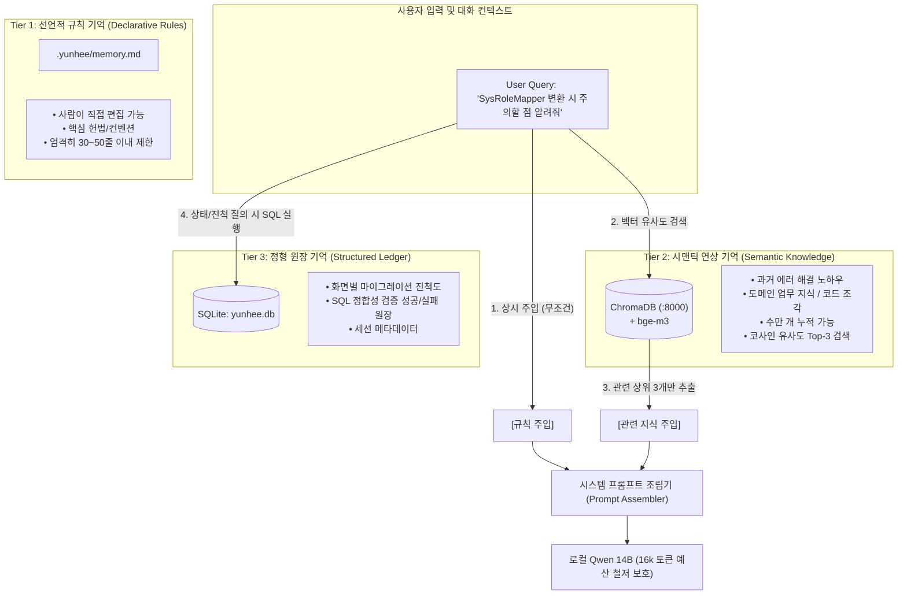

# yunhee-cli 하이브리드 메모리(Hybrid Memory) 아키텍처 설계서

- **작성일**: 2026-10-22
- **목적**: `yunhee-cli`의 대화형 에이전트 하네스 환경에서 단순 텍스트 파일(Markdown) 기반 기억의 토큰 잠식 및 검색 한계를 극복하고, 사내 인프라(ChromaDB + SQLite)를 결합한 **3계층 하이브리드 장기 기억(Hybrid Long-term Memory) 시스템** 구축.
- **연관 문서**: `docs/하네스-설계.md`, `docs/하네스-평가.md`, `implementation-plan-harness.md`

---

## 1. 배경: "Markdown 파일만으로 충분한가?"에 대한 기술적 검토

### 1.1 Markdown 단독 기록의 장점
- **직관성 및 제어권**: `.yunhee/memory.md` 같은 마크다운 파일은 개발자가 언제든지 텍스트 에디터로 직접 열어서 수정, 삭제, 추가할 수 있으며 버전 관리(Git)가 용이합니다.
- **결정론적(Deterministic) 주입**: 파일 내용을 시스템 프롬프트에 그대로 삽입하므로 검색 누락(Retrieval Miss) 없이 모델이 100% 읽게 됩니다.

### 1.2 Markdown 단독 기록의 명백한 한계
그러나 실제 대규모 마이그레이션 프로젝트를 장기간 진행할 경우, Markdown 단독 방식은 다음과 같은 치명적인 병목에 부딪힙니다:

1. **컨텍스트 윈도우(16k 토큰) 잠식**:
   - `yunhee`의 로컬 추론 모델인 `qwen2.5-coder:14b`의 최대 컨텍스트는 **16,384 토큰**입니다.
   - 대화 세션이 거듭되며 기억해야 할 지식(트러블슈팅 사례, 비즈니스 룰, API 명세, 코드 스니펫 등)이 수십~수백 개로 늘어나면 Markdown 파일 크기가 수만 자에 달하게 됩니다.
   - 이를 매 프롬프트마다 전체 주입하면 정작 **현재 분석하고 수정해야 할 소스 코드나 SQL을 담을 컨텍스트 예산이 고갈**됩니다.
2. **주의력 분산 (Attention Pollution)**:
   - 현재 작업이 "MyBatis XML SQL 변환"인데, 과거에 기록된 "React Tab 컴포넌트 CSS 스타일", "Docker 네트워크 설정"까지 모델이 전부 읽게 되면, 모델의 주의 집중도가 떨어져 환각(Hallucination)이나 엉뚱한 결론을 유출합니다.
3. **유사도 기반 회상(Retrieval)의 부재**:
   - 수백 개의 지식 중에서 **"지금 사용자의 질문과 가장 밀접한 지식 상위 2~3개"**만 골라내는 시맨틱 검색이 불가능하며, 전부 읽히거나 아예 읽히지 않는 극단적 선택만 강제됩니다.
4. **정형 데이터(진척도, 상태, 통계) 관리 불가**:
   - "전체 120개 화면 중 변환 완료된 화면 목록", "검증 실패한 SQL 목록"과 같은 상태 원장은 비정형 마크다운 텍스트로는 신뢰성 있는 집계와 상태 갱신이 불가능합니다.

---

## 2. 3계층 하이브리드 기억 모델 (3-Tier Hybrid Memory Architecture)

`yunhee`는 이미 호스트 환경에 **ChromaDB(포트 8000, bge-m3 고성능 임베딩)**와 **SQLite(`data/db/yunhee.db`)**를 갖추고 있습니다. 따라서 기억의 특성에 맞춰 역할을 3계층으로 분리합니다.



---

## 3. 계층별 상세 명세

### 3.1 Tier 1: 선언적 핵심 규칙 (L1. Declarative Rules)
- **저장소**: `WORK_DIR/.yunhee/memory.md` (로컬 프로젝트 단위)
- **역할**: 에이전트가 항상 인지하고 준수해야 하는 **프로젝트 헌법(Rules of Engagement)**.
- **내용 예시**:
  - "이 프로젝트의 Java 버전은 21이며, DTO는 원칙적으로 `record`로 작성한다."
  - "DB는 PostgreSQL 기반의 `asseterpdb`를 기준으로 한다."
  - "모든 API 호출 시 공통 응답 봉투(`CommonResponse<T>`)를 언래핑하여 처리한다."
- **토큰 방어 정책**:
  - **최대 라인 수 제한**: 최대 40라인 (약 400~600 토큰 이내)으로 강제.
  - 40라인 초과 시 에이전트가 `save_rule` 도구를 호출할 때 자동으로 오래된 비핵심 항목을 경고하거나 정리를 요청.
  - 사람이 언제든지 Git으로 추적하고 VS Code나 vim으로 수정 가능.

---

### 3.2 Tier 2: 시맨틱 연상 지식 (L2. Semantic Knowledge)
- **저장소**: Docker ChromaDB (`http://localhost:8000`), 컬렉션명 `yunhee_knowledge`
- **임베딩 모델**: 로컬 Ollama `bge-m3:latest` (다국어/코드 특화, 1024차원)
- **역할**: 대화 및 작업 도중 축적되는 방대한 **경험, 노하우, 복잡한 비즈니스 규칙, 코드 패턴**.
- **구조 (Chroma Document Schema)**:
  ```json
  {
    "id": "kb_20261022_120401_sysrole",
    "document": "[SysRoleMapper 특이사항] SysRoleMapper의 deleteRole 호출 시 연관 테이블 sys04_user_role의 cascade 삭제가 DB 트리거로 처리되지 않으므로 서비스 레이어에서 명시적으로 먼저 삭제해야 함.",
    "metadata": {
      "title": "SysRoleMapper 연관 삭제 주의사항",
      "category": "mybatis_migration",
      "target_screen": "sys04",
      "created_at": "2026-10-22T12:04:01",
      "source_session": "2026-10-22_105437"
    }
  }
  ```
- **동작 방식**:
  - 사용자가 질문을 입력하면, 에이전트 루프가 프롬프트를 전송하기 직전에 질문 텍스트를 `bge-m3`로 임베딩하여 ChromaDB에서 **거리(Distance) 0.4 이하의 상위 3개(Top-3) 지식만 선별**.
  - 선별된 지식만 `[참고 가능한 과거 지식]` 섹션으로 프롬프트에 동적 삽입 (평균 300~500 토큰 소모).
  - 관련 지식이 없으면 토큰을 전혀 소모하지 않음 (0 토큰).
  - 지식이 수천 건 축적되어도 **16k 토큰 제약에 전혀 영향을 주지 않는 완전한 O(1) 토큰 확장성** 보장.

---

### 3.3 Tier 3: 정형 원장 기억 (L3. Structured Ledger)
- **저장소**: SQLite `data/db/yunhee.db`
- **역할**: 마이그레이션 진척도, 검증 결과 통계 등 **수치적이고 정형화된 상태 추적**.
- **테이블 스키마 설계**:
  ```sql
  -- 1. 마이그레이션 진척도 원장
  CREATE TABLE IF NOT EXISTS migration_ledger (
      screen_id TEXT PRIMARY KEY,        -- 예: 'sys01', 'ast04'
      domain TEXT NOT NULL,              -- 예: 'sys', 'ast'
      status TEXT NOT NULL,              -- 'TODO', 'ANALYZED', 'PORTING', 'VERIFIED', 'DONE'
      asis_class TEXT,                   -- AS-IS 진입점 클래스
      tobe_page TEXT,                    -- TOBE React/TSX 파일 경로
      sql_verified_count INTEGER DEFAULT 0, -- 검증된 SQL 개수
      notes TEXT,                        -- 비고 및 특이사항
      updated_at TIMESTAMP DEFAULT CURRENT_TIMESTAMP
  );

  -- 2. 세션 및 상호작용 색인
  CREATE TABLE IF NOT EXISTS session_index (
      session_id TEXT PRIMARY KEY,
      started_at TIMESTAMP NOT NULL,
      summary TEXT,
      total_user_turns INTEGER,
      tools_invoked_count INTEGER,
      log_file_md TEXT,
      log_file_jsonl TEXT
  );
  ```
- **동작 방식**:
  - 사용자가 "현재 sys 도메인 마이그레이션 얼마나 진행됐어?"라고 물으면, LLM이 추측하지 않고 `query_ledger("SELECT * FROM migration_ledger WHERE domain = 'sys'")` 도구를 호출하여 정확한 통계를 확인하고 보고.

---

## 4. 에이전트 도구(Tool) 인터페이스 설계

에이전트가 기억을 다루기 위해 탑재될 전용 도구 모음 (`src/yunhee/agent/tools/core_memory.py`):

```python
# 1. Tier 1: 규칙 기억 도구
def save_rule(rule: str) -> str:
    """
    사용자의 영구 코딩 컨벤션, 핵심 프로젝트 규칙을 .yunhee/memory.md에 한 줄 추가합니다.
    중복된 규칙은 배제하며, 파일이 40라인을 초과하지 않도록 관리합니다.
    """

# 2. Tier 2: 시맨틱 지식 저장 도구
def save_knowledge(title: str, content: str, category: str = "general", screen_id: str = "") -> str:
    """
    에러 해결 노하우, 비즈니스 특이사항, 코드 포팅 팁 등 재사용 가능한 지식을 
    ChromaDB 벡터 스토어에 영구 저장합니다. (bge-m3 임베딩)
    """

# 3. Tier 2: 시맨틱 지식 능동 검색 도구
def search_knowledge(query: str, limit: int = 3) -> str:
    """
    과거에 축적된 지식 베이스(ChromaDB)에서 현재 작업과 유사한 노하우 및 해결 사례를 검색합니다.
    """

# 4. Tier 3: 진척도 원장 갱신 도구
def update_progress(screen_id: str, status: str, notes: str = "") -> str:
    """
    특정 화면의 마이그레이션 진척 상태(TODO, ANALYZED, PORTING, VERIFIED, DONE)를
    SQLite 진척도 원장(migration_ledger)에 기록/갱신합니다.
    """
```

---

## 5. 토큰 예산 관리 정책 (Token Budget Control)

로컬 14B 모델의 16,384 컨텍스트 한계 내에서 기억 시스템이 차지하는 최대 토큰을 엄격히 통제합니다:

```text
[전체 컨텍스트 예산: 16,384 토큰]
├── 시스템 기본 프롬프트 (System Base): 1,200 토큰
├── [L1] 핵심 규칙 (.yunhee/memory.md): 최대 500 토큰 (약 40줄 상한)
├── [L2] 시맨틱 지식 (ChromaDB Top-3): 최대 800 토큰 (문서당 ~250자)
├── 작업 버퍼 (코드/파일/SQL/도구 실행결과): 10,000 토큰 (가장 큰 비중 보장)
├── 대화 턴 히스토리 (최근 5~10턴 슬라이딩 윈도우): 2,500 토큰
└── 모델 생성 답변 예산 (Output Budget): 1,384 토큰
```

- **슬라이딩 윈도우 & 자동 요약**: 대화가 길어져 히스토리가 2,500 토큰을 넘어가면, 오래된 대화 턴은 핵심 내용 1줄 요약으로 치환(Compaction)하여 컨텍스트 초과를 원천 방어합니다.

---

## 6. 대화형 REPL 사용자 UX (슬래시 커맨드 확장)

사용자가 기억 시스템의 상태를 직접 확인하고 조작할 수 있도록 REPL 슬래시 커맨드를 제공합니다:

| 커맨드 | 동작 및 출력 내용 |
| :--- | :--- |
| **`/memory`** | L1 핵심 규칙(`.yunhee/memory.md`) 전문 및 L2/L3 누적 통계(ChromaDB 문서 수, 진척 화면 수) 출력 |
| **`/memory add <규칙>`** | 대화 없이 직접 L1 핵심 규칙을 한 줄 추가 |
| **`/knowledge <검색어>`** | ChromaDB에 저장된 과거 지식 벡터 검색 결과 즉시 확인 |
| **`/ledger [도메인]`** | SQLite 원장에 기록된 화면별 마이그레이션 진척 현황 테이블 출력 |

---

## 7. 단계별 구현 로드맵

1. **Step 1: L1 규칙 관리자 (`src/yunhee/agent/memory.py`)**
   - `WORK_DIR/.yunhee/memory.md` 읽기/쓰기/줄수 제한(40줄) 가드 구현.
   - `save_rule` 도구 구현 및 시스템 프롬프트 상시 주입 연동.
2. **Step 2: L2 ChromaDB 시맨틱 지식 연동 (`src/yunhee/agent/knowledge.py`)**
   - 사내 Docker ChromaDB(`:8000`) 클라이언트 및 `bge-m3` 임베딩 파이프라인 연결.
   - `save_knowledge`, `search_knowledge` 도구 구현 및 쿼리 전 자동 Top-3 프리패치(Prefetch) 연동.
3. **Step 3: L3 SQLite 진척도 원장 (`src/yunhee/store/ledger.py`)**
   - `data/db/yunhee.db`에 `migration_ledger` 테이블 생성.
   - `update_progress` 도구 및 `/ledger` 커맨드 연동.
4. **Step 4: REPL 본체 탑재 (`src/yunhee/ui/repl.py`)**
   - `/memory`, `/knowledge`, `/ledger` 커맨드 일체화 및 회귀 테스트.

---

## 8. 요약 및 결론

- **Markdown 단독 기록은 출발점일 뿐, 최종 해결책이 될 수 없습니다.**
- 사람이 직접 통제해야 하는 핵심 원칙은 **Markdown(L1)**에 담고, 계속 늘어나는 지식과 노하우는 **ChromaDB(L2)**로 벡터화하여 필요할 때만 소환하며, 수치와 진척도는 **SQLite(L3)**로 정형 관리하는 **3계층 하이브리드 모델**이야말로 14B 로컬 모델의 16k 토큰 제약 속에서 영구 기억을 실현하는 최적의 아키텍처입니다.
