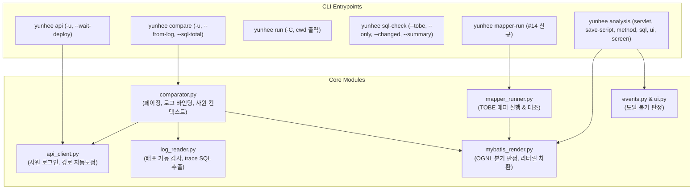

# [수정사항 039 반영 계획] yunhee 0.4.3 구현 계획

`docs/수정사항039.md`에 제시된 16개 결점 및 개선 요구사항(#1 ~ #16)을 해결하여 `yunhee 0.4.3`으로 업그레이드하기 위한 기술 설계 및 구현 계획 문서입니다.

---

## 1. Goal Description (목표 설명)

AssetERP 마이그레이션 세션(F09, F10, F12)에서 도출된 생산성 저하 요인 및 자동화 검증 한계를 극복하기 위해 아래 16가지 기능을 구현합니다:
1. **서버 메서드 위임 추적 (#1)**: 단순 위임(`new X().y()`) 시 대상 메서드·줄 수·SQL 목록 추적 및 `analysis method --server --follow`, `ℹ 위임 전용` 안내
2. **서블릿 다운로드 분석 (#2)**: 클라이언트의 서블릿 호출(`FileDownload?fileType=...`) 색인 및 `yunhee analysis servlet <이름> [--type <fileType>]` 추가
3. **페이징 응답 지원 (#3)**: `yunhee compare`의 `PageRes{total, rows}` 인식, `--sql-total <ns.id>` 비교 및 `[compare] paging_keys` 설정
4. **TOBE 매퍼 검증 필터 (#4)**: `sql-check --tobe`에 `--only <glob>`, `--changed` (git diff), `--summary` (한 줄 요약), 필터 내 오류 발생 시에만 exit 1
5. **PreToolUse 훅 따옴표/heredoc 예외 (#5)**: `yunhee-guard.sh`가 명령 위치(줄 시작, `;`, `&&`, `||`, `|` 다음)만 검사하고 heredoc/따옴표/인자 내 텍스트 통과
6. **API 경로 자동 보정 (#6)**: `yunhee api` 호출 시 `/api/v1/` 누락 시 자동 보정 및 재시도, `[api] auto_prefix` 설정
7. **외부 명령 실행 cwd 지원 (#7)**: `yunhee run` 실행 전 `cwd: ...` 출력, `-C <dir>` / `--cwd`, `.yunhee.toml` 기본값 지원 및 존재하지 않는 폴더 사전 차단
8. **SQL include 정리 및 grep (#8)**: `analysis sql -o code`에서 미참조 include 주석 제거, `--grep <패턴>` 및 `-C <줄수>` 문맥 검색 지원
9. **실행 가능 SQL 파라미터 치환 (#9)**: `analysis sql -o sql --param k=v`의 `#{k}` 리터럴 대입, 조건 분기 평가 및 미지정 변수 `:k` 표시, 경고는 stderr로 격리
10. **저장 스크립트 일괄 생성 (#10)**: `yunhee analysis save-script <ns.Class.method>`로 CUD SQL 순차 추출, `--branch` 분기 선택, 루프 파라미터 전개
11. **배포 직후 기동 감지 (#11)**: `yunhee api`가 404 시 배포 후 미기동 상태 감지 안내 및 `--wait-deploy [초]` 대기 옵션
12. **사원 계정 전환 (#12)**: `yunhee api`·`compare`에 `-u <사원ID>` (`--as`), `.env.local`의 `YUNHEE_TEST_ACCOUNTS` 기반 로그인 및 `user/org/company` 헤더/기본값 주입
13. **로그 기반 파라미터 자동 바인딩 (#13)**: `compare --from-log`로 직전 API 호출 trace의 매퍼 바인딩 파라미터를 자동 로드
14. **TOBE 매퍼 실행 및 대조 (#14)**: `yunhee mapper-run <매퍼파일>#<statement>`로 파라미터 치환 실행 및 `--compare <ns.id>` AS-IS SQL 대조
15. **도달 불가 이벤트 판별 (#15)**: 미호출 메서드 및 비연결 위젯의 이벤트를 `⚠ 도달 불가`로 표시하고 `analysis ui --unreachable ignore`로 모수 제외
16. **패키지 접두 및 유사 후보 (#16)**: `analysis method <패키지>.<클래스>.<메서드>` 인식 및 오타 시 유사 메서드/생성자 후보 제시 (Exit 2)

---

## 2. User Review Required (사용자 검토 필요 사항)

> [!IMPORTANT]
> - **버전 업그레이드**: `pyproject.toml` 및 `src/yunhee/CHANGELOG.md` 버전을 `0.4.2`에서 `0.4.3`으로 올립니다.
> - **PreToolUse 훅 수정**: `framework-sprt/.claude/hooks/yunhee-guard.sh` 및 `yunhee-guard.test.sh`를 수정하여 셸 토큰 기반 명령 위치 검사로 개선합니다.
> - **`YUNHEE_TEST_ACCOUNTS` 환경변수 규격**: `.env.local.sample`에 `YUNHEE_TEST_ACCOUNTS="202204180108329:1111,admin:1111"` 예시를 추가합니다.

---

## 3. Architecture & Data Flow



---

## 4. Proposed Changes (변경 상세 계획)

### Component 1: `yunhee/tools/analysis/method.py` & `screen.py` (#1, #16)
#### [MODIFY] [method.py](file:///home/kdy987/work/yunhee-cli/src/yunhee/tools/analysis/method.py)
- `<패키지>.<클래스>.<메서드>` 형식 파싱: `.`이 2개 이상일 때 마지막 두 개는 `클래스.메서드`, 앞부분은 패키지 디렉터리로 취급하여 `app / "server" / pkg` 우선 검색 (#16).
- 클래스/메서드 미발견 시: 해당 클래스 내 메서드 목록과 `difflib.get_close_matches`를 비교하여 최대 3개의 후보 제시. 클래스명과 동일한 메서드는 `<클래스>.<클래스> (생성자)`로 표기 후 `Exit 2` (#16).
- `--follow` 옵션 추가: 서버 메서드가 1~3줄의 단순 위임(`new X().y(request...)` 등)인 경우 대상 `X.y`의 줄 범위와 호출 SQL 목록을 1~2단계 재귀적으로 추적하여 출력 (#1).
- 경고 억제: 메서드가 `void` 반환이고 `result.setStatus`가 없으며 단순 위임인 경우 `⚠ 결과 없음` 대신 `ℹ 위임 전용` 출력 (#1).

#### [MODIFY] [screen.py](file:///home/kdy987/work/yunhee-cli/src/yunhee/tools/analysis/screen.py)
- `_format_service_rows`: 서비스 메서드가 단순 위임인 경우 1단계 추적하여 비고 열에 `→ Apr10_StampPDF7.getInDocument L1121-1215 (SQL 4, 하위 makeDocument L699-1115 SQL 15)`와 같이 줄 수 및 SQL 수 표기 (#1).
- `--section servlet`: 색인의 `## 서블릿 호출` 절 추출 및 렌더링 (#2).
- `--section events`: 도달 불가 이벤트(`⚠ 도달 불가`) 표시 반영 (#15).

---

### Component 2: 서블릿 분석 및 색인 (#2)
#### [NEW] [servlet.py](file:///home/kdy987/work/yunhee-cli/src/yunhee/tools/analysis/servlet.py)
- `yunhee analysis servlet <이름> [--type <fileType>] [-o code|md]`
- `server/utils/file/<이름>.java` (예: `FileDownload.java`)를 탐색하여 `service` 메서드의 `fileType` 분기문(`if ("apprList".equals(fileType))`) 및 호출 메서드(`downloadApprList`) 정적 파싱.
- `-o code`: 해당 메서드 줄 범위(예: L281-310) 본문 출력.
- `-o md`: 분기 조건, SQL ID (`sys10_file.selectByParentId`), 응답 헤더 (`Content-Disposition`, zip 이름 `Asset-ERP_DOC`), 번호 규칙 분기 요약.

#### [MODIFY] [src_indexer.py](file:///home/kdy987/work/yunhee-cli/src/yunhee/tools/as_is/src_indexer.py)
- 클라이언트 소스 파싱 시 `"FileDownload?fileType=<값>"` 및 `FileUpload?...` 문자열 및 뒤따르는 쿼리 파라미터(`selectList` 등) 추출.
- 화면 마크다운 파일에 `## 서블릿 호출` 섹션 추가:
  `FileDownload fileType=apprList selectList=… (L303-309)`

---

### Component 3: `comparator.py` & `api_client.py` (#3, #6, #11, #12, #13)
#### [MODIFY] [comparator.py](file:///home/kdy987/work/yunhee-cli/src/yunhee/tools/comparator.py)
- 페이징 응답 처리 (#3):
  - `data`가 객체이고 `[compare] paging_keys` (기본 `["rows", "total"]`)가 존재하면 페이징 모드로 전환.
  - 행 목록은 `rows` 배열로 카운트, 필드 대조는 `rows[0]`의 키 집합으로 수행.
  - `--sql-total <ns.id>` 지정 시 SQL 총건수를 조회하여 `API total={n}, SQL total={m}` 비교.
- 사원 계정 전환 `-u` (`--as`) (#12):
  - `api_client`에 사원 ID 전달하여 로그인 세션 확보.
  - 세션에서 추출된 `userId`, `orgId`, `companyId`를 `empId`, `orgId`, `companyId` 미지정 시 SQL 파라미터 기본값으로 주입.
- `--from-log` 지원 (#13):
  - API 호출 후 반환된 `trace_id`를 사용하여 로그에서 동일 statement(`selectByBoxId`)의 바인딩 파라미터 추출.
  - 추출된 값을 `sql_params` 기본값으로 적용하고 사용한 파라미터 목록 표시. CLI 직접 입력 `--param`이 우선.

#### [MODIFY] [api_client.py](file:///home/kdy987/work/yunhee-cli/src/yunhee/tools/api_client.py)
- 자동 경로 보정 (#6):
  - 경로가 `/api/`로 시작하지 않고 `v1/` 또는 도메인명(`dcr/`, `apr/`, `fbx/` 등)으로 시작하여 404가 발생하면 `/api/v1/` 접두를 붙여 자동 재시도.
  - `ℹ 경로를 /api/v1/... 로 보정` 한 줄 안내 출력. `[api] auto_prefix` 설정 지원.
- 배포 직후 404 감지 및 `--wait-deploy` (#11):
  - 404 수신 시 `check_deploy_startup_staleness`를 확인하여 배포 후 기동 기록이 없으면 `ℹ 배포 후 앱이 아직 올라오는 중일 수 있음 (배포 HH:MM, 기동 기록 없음) — 잠시 뒤 다시` 출력.
  - `--wait-deploy [초]` 옵션 시 기동 기록이 생길 때까지 대기 후 요청 실행.
- 사원 계정 `-u` / `--as` 로그인 (#12):
  - `.env.local`의 `YUNHEE_TEST_ACCOUNTS`에서 사원/로그인ID에 매핑된 비밀번호 조회.
  - 로그인 성공 시 응답 헤더에 `user=<id> org=<id> company=<id>` 출력.

---

### Component 4: `sql_checker.py` (#4)
#### [MODIFY] [sql_checker.py](file:///home/kdy987/work/yunhee-cli/src/yunhee/tools/as_is/sql_checker.py)
- `check_tobe_sql`:
  - `--only <매퍼명|glob>`: 대상 매퍼 필터링 (반복 가능).
  - `--changed`: `git diff --name-only` 및 untracked 목록을 조회하여 변경된 매퍼 XML만 필터링.
  - `--summary`: 매퍼별 `✅ n / ❌ m` 한 줄 요약 및 ❌ statement만 상세 출력.
  - 종료 코드: 필터링된 대상 범위 내에 ❌가 있을 때만 1, 없으면 0 반환.

---

### Component 5: PreToolUse 훅 `yunhee-guard.sh` (#5)
#### [MODIFY] `/home/kdy987/work/framework-sprt/.claude/hooks/yunhee-guard.sh`
- 명령어를 파싱하여 heredoc(`<<'EOF'` ~ `EOF`), 따옴표(`"..."`, `'...'`), `bash -c '...'`, `python3 - <<EOF` 내부를 완전 제외.
- 오직 실제 명령 실행 위치(줄 시작, `;`, `&&`, `||`, `|` 다음의 첫 토큰)의 `cat/sed/head/tail/awk/grep -A/-B/-C`만 검사.
- `framework-sprt/.claude/hooks/yunhee-guard.test.sh` 및 `yunhee-cli/tools/hook-test.sh`에 7가지 검증 케이스 추가 및 확인.

---

### Component 6: `runner.py` & CLI `run` (#7)
#### [MODIFY] [runner.py](file:///home/kdy987/work/yunhee-cli/src/yunhee/tools/runner.py) & [cli.py](file:///home/kdy987/work/yunhee-cli/src/yunhee/cli.py)
- `yunhee run` 실행 직전 콘솔 및 로그 최상단에 `cwd: <절대경로>` 출력.
- `-C <디렉터리>` / `--cwd`: 해당 디렉터리로 전환하여 실행. `.yunhee.toml`의 `[run] cwd` 기본값 지원.
- 디렉터리가 존재하지 않을 경우 `실행 전 오류: 디렉터리 없음` 출력 후 프로세스 실행 없이 즉시 종료.

---

### Component 7: `analysis sql` & `mybatis_render.py` (#8, #9)
#### [MODIFY] [sql.py](file:///home/kdy987/work/yunhee-cli/src/yunhee/tools/analysis/sql.py)
- `-o code`: `<sql>` 태그 자신이 직접 포함하지 않는 include 주석 배제 (#8).
- `--grep <패턴>` 및 `-C <줄수>`: 매칭 라인 및 전후 문맥 라인만 발췌 출력 (#8).
- `미발견` include는 코드 최하단에 `⚠ include 미발견: id1`로 한 번만 요약 (#8).
- 경고 문구(`⚠`)는 모두 `sys.stderr`로 출력하여 stdout을 파일로 리다이렉트하거나 `yunhee sql -f`로 안전하게 파이프 가능하도록 보장 (#9).

#### [MODIFY] [mybatis_render.py](file:///home/kdy987/work/yunhee-cli/src/yunhee/tools/as_is/mybatis_render.py)
- `mode="params"` 렌더링 개선 (#9):
  - `#{k}` 대입 시 문자열은 따옴표 `'...'`, 날짜는 `'YYYY-MM-DD'` 처리.
  - 파라미터가 누락된 경우 `NULL` 대신 `:k` 자리표시 및 `-- 필요: k` 주석 생성.
  - `<if>` 및 `<choose>`: 전달된 파라미터로 참/거짓 평가하여 일치하는 분기만 펼침.
  - 계산에서 제외된 분기는 `-- 분기 제외: <변수>` 주석 남김. 미평가 분기는 `/* if ... */ ... /* end */` 처리.

---

### Component 8: `save_script.py` (#10)
#### [NEW] [save_script.py](file:///home/kdy987/work/yunhee-cli/src/yunhee/tools/analysis/save_script.py)
- `yunhee analysis save-script <ns.Class.method> --param k=v … [--branch key=val]`
- 서버 메서드의 `sqlSession` 호출 중 쓰기(insert/update/delete) SQL 순차 추출.
- `if` 분기는 `--branch` 옵션 값에 따라 선택적 포함.
- 루프 내부 호출은 `--param`의 쉼표 구분 리스트(`disposalListId=1,2`)만큼 반복 전개.
- 파일 머리에 `-- yunhee sql -f 로 --rollback 실행` 안내문 배치.

---

### Component 9: `mapper_runner.py` (#14)
#### [NEW] [mapper_runner.py](file:///home/kdy987/work/yunhee-cli/src/yunhee/tools/as_is/mapper_runner.py)
- `yunhee mapper-run <매퍼파일>#<statement_id> --param k=v … [--count | --rows N] [--compare <ns.id>] [--rollback]`
- TOBE 매퍼 XML statement를 파라미터 대입하여 DB에서 읽기 전용 실행 (쓰기는 `--rollback` 필수).
- `--compare <ns.id>` 지정 시 동일 파라미터로 AS-IS SQL을 실행하여 결과 행 수, 열 목록(`TOBE ⊇ 그리드 열`), 첫 행 비교 리포트 출력.

---

### Component 10: 도달 불가 이벤트 판별 (#15)
#### [MODIFY] [events.py](file:///home/kdy987/work/yunhee-cli/src/yunhee/tools/as_is/events.py) & [ui.py](file:///home/kdy987/work/yunhee-cli/src/yunhee/tools/analysis/ui.py)
- `events.py`:
  - 호출처가 없는 메서드(`deleteRow()`) 내부의 이벤트 및 화면 컴포넌트 트리에 연결되지 않은 위젯(`statusComboBox`) 핸들러에 `⚠ 도달 불가` 플래그 및 마킹 추가.
  - 색인 생성 시 `(도달 불가: deleteRow() 호출처 없음)` 표기.
- `ui.py`:
  - `--unreachable ignore|count` (기본 `count`) 옵션 추가.
  - `ignore` 지정 시 도달 불가 이벤트를 AS-IS 모수에서 제외하여 `4/4`와 같이 계산.

---

### Component 11: 설정 및 패키지 메타데이터 갱신
#### [MODIFY] [pyproject.toml](file:///home/kdy987/work/yunhee-cli/pyproject.toml) & [CHANGELOG.md](file:///home/kdy987/work/yunhee-cli/src/yunhee/CHANGELOG.md)
- 버전을 `0.4.3`으로 올림.
- CHANGELOG에 수정사항 039 반영 내역 기록.

---

## 5. Verification Plan (검증 계획)

### Automated Tests
1. **기존 회귀 테스트 통과**:
   ```bash
   uv run pytest
   uv run ruff check .
   ```
2. **039 신규 단위 테스트 추가 (`tests/test_fix039.py`)**:
   - #1: 위임 체인 추적 및 void 위임 전용 안내 테스트
   - #2: 서블릿 `FileDownload` 추출 및 `analysis servlet` 테스트
   - #3: `compare` 페이징 응답 및 `--sql-total` 테스트
   - #4: `sql-check --tobe`의 `--only`, `--changed`, `--summary` 테스트
   - #5: 훅 스크립트 단위 시험 (`tools/hook-test.sh`의 ①~⑦ 항목)
   - #6: `api` 경로 자동 보정(`/api/v1/`) 테스트
   - #7: `run`의 `-C` 및 존재하지 않는 폴더 사전 오류 테스트
   - #8: `analysis sql` 미참조 include 제외 및 `--grep` 테스트
   - #9: `analysis sql -o sql`의 파라미터 치환, 분기 계산, `:k` 표시 테스트
   - #10: `analysis save-script`의 SQL 전개 및 `--branch` 테스트
   - #11: 배포 직후 기동 감지 및 `--wait-deploy` 테스트
   - #12: `-u` 사원 계정 전환 및 헤더 출력 테스트
   - #13: `compare --from-log` 바인딩 파라미터 로드 테스트
   - #14: `mapper-run` 및 `--compare` 테스트
   - #15: `analysis ui --unreachable ignore` 및 도달 불가 마킹 테스트
   - #16: `analysis method` 패키지 접두 및 후보 제시 테스트

### Manual / Integration Verification (AssetERP 환경)
1. `uv tool install --editable .`로 전역 yunhee 갱신.
2. `수정사항039.md`의 고정 시나리오 실행:
   - `yunhee compare GET /api/v1/fbx/files/by-box -c kfstest -u 202204180108329 -p boxId=202205130124053 --sql fbx03_file.selectByBoxId --param boxId=202205130124053 --param fileName=% --param regEmpName=% --grid Fbx01_Grid_DocList`
   - `yunhee analysis screen Fbx01_Tab_Search --class Fbx01_Tab_Search --section events`
   - `yunhee analysis ui Fbx01_Tab_Search --tobe frontend/src/pages/fbx --unreachable ignore`
   - `yunhee analysis method fbx.Fbx03_File.selectByBoxId --server -o code`
   - `yunhee analysis method Fbx01_Grid_DocList.init`
   - `yunhee analysis sql common.dcr_tree_down -o code --grep 'type_cd' -C 2`
   - `yunhee analysis sql apr90_disposal_list.selectByCompanyId -o sql --param companyId=28000 --param startDate=2020-01-01 --param closeDate=2026-12-31 --param disposalCode=% --param confirmEmpId=29049`
   - `yunhee analysis save-script apr.Apr90_DisposalList.updateAppr --param disposalCode=20 --param confirmEmpId=1 --param companyId=28000 --param disposalListId=202512109205061 --param apprId=202508189001993`
   - `yunhee mapper-run backend/src/main/resources/mapper/FbxFileMapper.xml#selectByBoxId --param boxId=202205130124053 --param orgId=0 --param empId=202204180108329 --param companyId=28000 --param fileName=% --param regEmpName=% --compare fbx03_file.selectByBoxId`
3. 작업 완료 후 `수정사항039.md`의 "확인 결과" 표 업데이트 및 ntfy 알림 전송:
   ```bash
   curl -s -d "agy message: 수정사항039 (0.4.3) 반영 및 검증 작업 끝 남" ntfy.sh/asseterp-framework-gwtgxt-2-sbreact-2026
   ```
