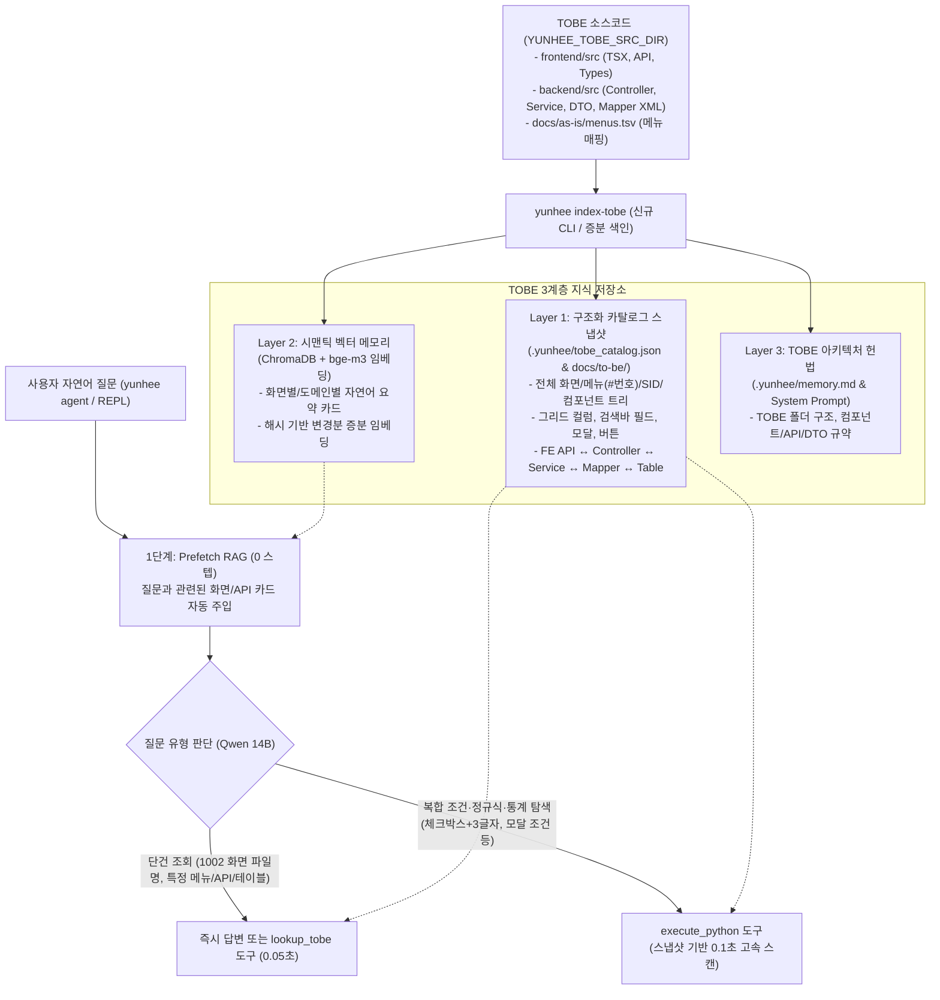

# `yunhee agent` TOBE 프로젝트 종합 학습(Indexing & Grounding) 계획서

## 1. 배경 및 문제 진단

현재 `yunhee`는 **AS-IS(GXT/Java 8)**에 대해서는 `yunhee index-src`와 `yunhee index-db`를 통해 `docs/as-is/` 아래에 체계적인 정적 색인을 구축하고 있으나, **TOBE(React/TypeScript + Spring Boot/Java 21 + MyBatis)**에 대해서는 다음과 같은 공백이 있습니다:

1. **사전 구축된 TOBE 영구 색인(Snapshot) 부재**:
   - 질문이 들어올 때마다 실시간으로 수백 개의 `.tsx`, `.java`, `.xml` 파일을 매번 파싱(`build_index`)하므로 `execute_python` 실행에 5~6초가 소요됩니다.
2. **시맨틱 지식 스토어(`ChromaDB` + `bge-m3`) 미활용**:
   - `AgentLoop`에 `prefetch_relevant_knowledge()`(L2 RAG) 구조가 이미 구현되어 있으나, TOBE 화면/API/컴포넌트 정보가 ChromaDB에 인덱싱되어 있지 않아 `"1002 화면의 파일명은?"`, `"사원정보 관리 화면의 API는?"` 같은 기본 질문에도 매번 도구를 호출하거나 헤매게 됩니다.
3. **질문 유형별 대응 경로 미분리**:
   - **단건 식별 질의**(*"1002 화면의 파일명은?"*, *"업무별 문서작성 화면의 백엔드 파일은?"*, *"`/api/v1/ics/class-tree`를 호출하는 화면은?"*)와 **복합 조건 전수 탐색**(*"그리드 컬럼이 체크박스이면서 한글 3글자인 화면은?"*, *"모달 타이틀이 '법규분류 수정'인 화면은?"*)이 구분되지 않아 프롬프트 예시에 의존하고 있습니다.

---

## 2. 목표 아키텍처: 3계층 TOBE 학습(Grounding) 시스템

로컬 LLM(`qwen2.5-coder:14b`, 16k 컨텍스트)의 추론 부담과 토큰 소모를 최소화하면서 정확도를 100%로 끌어올리기 위해 **3계층 지식 구조**로 TOBE를 학습시킵니다.



---

## 3. 세부 구현 계획

### Phase 1: `yunhee index-tobe` 정적 카탈로그 스냅샷 빌더 구현
**대상 파일**: `src/yunhee/tools/trace/tobe_indexer.py` *(신규)*, `src/yunhee/tools/trace/screen_catalog.py` *(개선)*

1. **수집 대상 및 스키마 (`.yunhee/tobe_catalog.json`)**:
   - **`menus` (전체 메뉴 사전)**:
     - `menus.tsv`의 모든 메뉴 번호(`#1001`~)를 기준으로 **TOBE 변환 완료 여부(`migrated: true/false`)**, 연결된 TOBE 메인 `_Tab_` 파일 경로, 미변환 시 AS-IS Java 클래스 경로를 모두 기록합니다.
   - **`screens` (프론트엔드 화면 및 하위 컴포넌트 전체)**:
     - `name`, `file`, `role` (`Tab`, `TabPage`, `Grid`, `Lookup`, `Edit`, `Popup`, `Move`), `page_style` (`SG`, `SGP`, `MF` 등 SID).
     - `menu_no`, `menu_path`, `menu_name`, `opening_tabs` (상위 탭 역추적), `child_components` (하위 모달/그리드 목록).
     - `search_fields`: `<SearchBar.Field label="...">` 등 조회 조건 라벨 및 위젯 타입 목록.
     - `grid_cols`: `GridCol(col_type, field, label, width)` 목록.
     - `modals`: 정적 타이틀, JSX 타이틀, 부모 화면에서 전달하는 동적 `titleName`/`title` 및 JSDoc 설명.
     - `buttons`: 버튼 타입(`type="..."`) 및 라벨 목록.
     - `apis`, `backend_files`, `sql_ids`, `tables`: 이 화면이 호출하는 백엔드 전체 체인.
   - **`apis` & `backends` (백엔드 엔드포인트 및 매퍼 사전)**:
     - `FE api 함수` ↔ `HTTP Method + URL` ↔ `Controller.method (파일:줄)` ↔ `Service.method (파일:줄)` ↔ `Mapper.sql_id (파일:줄)` ↔ `Request/Response Record DTO` ↔ `DB 테이블 목록`.
2. **초고속 로드 및 자동 증분 갱신**:
   - `iter_screens()` 호출 시 `.yunhee/tobe_catalog.json`이 존재하면 수백 개 파일을 다시 파싱하지 않고 JSON 스냅샷에서 **0.05초 이내**에 로드합니다(변경된 파일만 mtime 비교로 부분 재파싱).
3. **사람/에이전트 열람용 마크다운 색인 (`docs/to-be/`) 생성**:
   - `docs/to-be/menus.md`: 전체 메뉴번호(`#번호`)별 TOBE 파일 경로·백엔드 파일·변환 상태 일람표.
   - `docs/to-be/domains/{domain}.md`: 도메인별 화면·모달·그리드·API·테이블 요약서.

---

### Phase 2: ChromaDB(`bge-m3`) 기반 TOBE 시맨틱 벡터 학습
**대상 파일**: `src/yunhee/agent/knowledge.py` *(개선)*, `src/yunhee/tools/trace/tobe_indexer.py`

1. **화면·도메인 단위 지식 카드(Knowledge Card) 자동 생성 및 임베딩**:
   - `yunhee index-tobe` 실행 시 각 메뉴/화면별로 아래 형태의 압축 텍스트 카드를 생성하여 ChromaDB(`yunhee_tobe_kb`)에 `bge-m3`로 임베딩합니다 (콘텐츠 SHA-256 해시를 비교해 변경된 화면만 재임베딩):
     ```text
     [화면 #1002 | 문서작성 > 01. 문서작성 > 업무별 문서작성 | Dcr01_Tab_DcrUser]
     - 프론트엔드 파일: frontend/src/pages/dcr/Dcr01_Tab_DcrUser.tsx (스타일: TG)
     - 하위 컴포넌트/모달: Dcr01_Lookup_... (모달: ...)
     - 조회 조건: 문서분류, 검색어 | 버튼: 찾기, 신규문서 작성
     - 그리드 컬럼: ...
     - 호출 API: GET /api/v1/dcr/...
     - 백엔드 파일: DcrController.java, DcrService.java, dcr01_dcr_user.xml
     - 관련 테이블: dcr01_dcr_user, dcr02_...
     ```
2. **Prefetch RAG 자동 소환 + 결정적 키워드 매칭 하이브리드**:
   - 사용자 질문에 **4자리 숫자(예: `1002`, `#1029`)**, **화면/컴포넌트 코드(예: `Ics01`, `Dcr01_Tab_DcrUser`)**, 또는 **메뉴명**이 포함되어 있으면:
     1) **결정적 매칭(Exact Match)**: 카탈로그에서 `#1002` 화면 카드를 즉시 꺼내 프롬프트 상단에 `[질문 관련 TOBE 화면 팩트]`로 자동 주입합니다.
     2) **시맨틱 검색(Vector Match)**: ChromaDB에서 유사도 상위 카드를 추가로 주입합니다.
   - **결과**: 사용자가 `"1002 화면의 파일명은?"`, `"1002 화면에서 쓰는 API와 백엔드 파일은?"`이라고 물으면 **도구 호출조차 필요 없이 1턴 만에 정확한 파일 경로와 연결 구조를 즉시 답변**합니다.

---

### Phase 3: 에이전트 전용 `lookup_tobe` 도구 및 `execute_python` API 강화
**대상 파일**: `src/yunhee/agent/tools/domain_helper.py`, `src/yunhee/agent/registry.py`, `src/yunhee/agent/loop.py`

1. **`lookup_tobe(query)` 만능 단건 조회 도구 추가**:
   - 인자 `query`로 **화면번호(`"1002"`), 메뉴명(`"업무별 문서작성"`), 컴포넌트명(`"Ics01_Edit_ClassTree"`), API 경로(`"/api/v1/ics"`), 테이블명(`"ics01_class_tree"`)** 중 무엇을 넣어도:
     - 매칭되는 TOBE 화면번호, 메뉴 경로, FE 파일 경로, 하위/상위 컴포넌트, 모달/그리드/버튼 요약, BE Controller/Service/Mapper 파일 경로를 한 번에 반환합니다.
     - 만약 아직 TOBE로 변환되지 않은 메뉴 번호라면 `"⚠ TOBE 미변환 화면 (AS-IS 원본: ...)"`으로 명확히 알려줍니다.
2. **`execute_python`용 카탈로그 헬퍼 API 확장**:
   - 복합 조건 질문(체크박스 + 한글 3글자, 모달 개수, 미연결 API 등)을 위해 `from yunhee.tools.trace.screen_catalog import iter_screens, find_screens`에서 사용할 수 있는 필드를 확장합니다:
     - `s.search_fields` (조회바 라벨 목록)
     - `s.page_style` (페이지 스타일 SID)
     - `s.child_components` (하위 컴포넌트 목록)
     - `s.tables` (연결된 DB 테이블 목록)

---

## 4. 질문 유형별 기대 동작 시나리오

| 사용자 질문 예시 | 처리 경로 | 응답 속도 및 결과 |
| :--- | :--- | :--- |
| **"1002 화면의 파일명은?"** | Prefetch 하이브리드 주입 (또는 `lookup_tobe("1002")`) | **~1초** — `#1002 (업무별 문서작성)`의 메인 TSX(`frontend/src/pages/dcr/Dcr01_Tab_DcrUser.tsx`), 하위 컴포넌트, 연결 백엔드 파일까지 즉시 출력 |
| **"업무별 문서작성 화면에서 호출하는 API와 백엔드 서비스 파일 알려줘"** | Prefetch 하이브리드 주입 + `lookup_tobe` | **~1~2초** — FE API 함수, HTTP URL, Controller, Service, Mapper XML 경로 및 SQL ID 출력 |
| **"'법규분류 수정' 타이틀을 갖는 모달을 찾아줘"** | `execute_python` (`.yunhee/tobe_catalog.json` 스냅샷 스캔) | **~1~2초** (기존 5.6초 → 스냅샷 로드로 단축) — `#1012 | 법규관리(관리자) | Ics01_Edit_ClassTree` 표 출력 |
| **"조회 조건(SearchBar)에 '펀드'가 들어가고 그리드에 체크박스가 있는 화면 찾아줘"** | `execute_python` (`s.search_fields` + `s.grid_cols` 복합 조건) | **~1~2초** — 조건에 부합하는 모든 TOBE 화면의 `[#화면번호, 메뉴명, 컴포넌트명, 파일경로, 일치상세]` 표 출력 |

---

## 5. 작업 순서 (Step-by-Step)

1. **Step 1**: `screen_catalog.py` 확장 (`search_fields`, `child_components`, `tables`, `page_style`, 미변환 메뉴 포함) 및 `.yunhee/tobe_catalog.json` 스냅샷 저장/증분 로드 구현 (`yunhee index-tobe` CLI 명령어 추가).
2. **Step 2**: `docs/to-be/menus.md` 생성기 및 ChromaDB(`bge-m3`) 시맨틱 카드 인덱서 연동 (`yunhee index-tobe` 실행 시 자동 수행).
3. **Step 3**: `AgentLoop`의 Prefetch 단계에 **화면번호/컴포넌트명/메뉴명 결정적 매칭 + ChromaDB 벡터 검색** 하이브리드 컨텍스트 주입기 연결 및 `lookup_tobe` 도구 등록.
4. **Step 4**: 단위 테스트 작성 및 실제 질의(`"1002 화면의 파일명은?"`, `"업무별 문서작성 화면 백엔드 파일은?"`, 복합 그리드/모달 조건 등) 검증.
