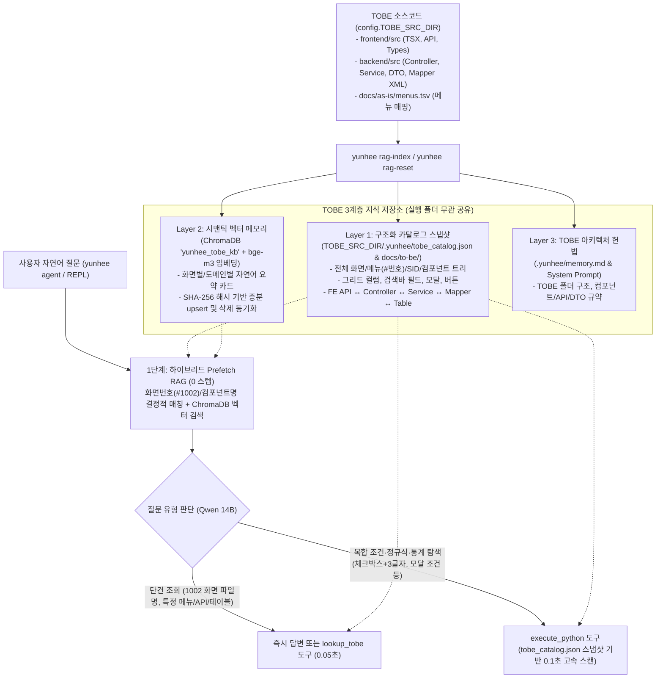

# `yunhee` TOBE 에이전트 RAG 학습 설계 (`tobe_agent_rag-설계.md`)

## 1. 배경 및 목적

현재 `yunhee`는 **AS-IS(GXT/Java 8)**에 대해서는 `yunhee index-src`와 `yunhee index-db`를 통해 정적 색인을 구축하고 있으나, **TOBE(React/TypeScript + Spring Boot/Java 21 + MyBatis)**에 대해서는 사전 학습된 스냅샷과 벡터 색인이 없어 다음과 같은 한계가 있습니다:

1. **매 질문마다 실시간 전체 파일 파싱**:
   - 질문이 들어올 때마다 수백 개의 `.tsx`, `.java`, `.xml` 파일을 매번 파싱(`build_index`)하므로 `execute_python` 실행에 5~6초가 소요됩니다.
2. **시맨틱 지식 스토어(`ChromaDB` + `bge-m3`) 미활용**:
   - `AgentLoop`에 `prefetch_relevant_knowledge()`(L2 RAG) 구조가 이미 구현되어 있으나, TOBE 화면/API/컴포넌트 정보가 ChromaDB에 학습되어 있지 않아 `"1002 화면의 파일명은?"`, `"사원정보 관리 화면의 API는?"` 같은 기본 질문에도 매번 도구를 호출해야 합니다.
3. **질문 유형별 대응 경로 미분리**:
   - **단건 식별 질의**(*"1002 화면의 파일명은?"*, *"업무별 문서작성 화면의 백엔드 파일은?"*)와 **복합 조건 전수 탐색**(*"그리드 컬럼이 체크박스이면서 한글 3글자인 화면은?"*, *"모달 타이틀이 '법규분류 수정'인 화면은?"*)을 모두 빠르게 처리할 수 있는 통합 RAG + 카탈로그 구조가 필요합니다.

---

## 2. 실행 위치 원칙 (`yunhee-cli` 폴더 vs. 대상 프로젝트 폴더)

> [!IMPORTANT]
> **`yunhee-cli` 폴더와 작업 대상 프로젝트(`AssetERP`) 폴더 중 어디서 명령을 내려도 100% 동일하게 동작하도록 설계합니다.**

- **학습 대상 소스 경로**: 항상 `config.TOBE_SRC_DIR`을 기준으로 삼습니다.
  - 대상 프로젝트 폴더(`AssetERP`) 안에서 실행하면 `WORK_DIR`이 곧 `TOBE_SRC_DIR`이 됩니다.
  - `yunhee-cli` 폴더에서 실행하더라도 `.env.local`의 `YUNHEE_TOBE_SRC_DIR`(`/home/kdy987/work/framework-sprt/AssetERP`)을 자동으로 바라봅니다.
- **학습 산출물(스냅샷 + 벡터) 저장 위치**:
  1. **ChromaDB 벡터 스토어**: Docker 컨테이너(`localhost:8000`)에서 동작하므로 어느 폴더에서 실행하든 동일한 `yunhee_tobe_kb` 컬렉션을 공유합니다.
  2. **카탈로그 JSON 스냅샷**: `TOBE_SRC_DIR/.yunhee/tobe_catalog.json`에 단일 기준으로 저장합니다.
  3. **마크다운 요약 문서**: `TOBE_SRC_DIR/docs/to-be/` 아래에 생성합니다.
- **결론**:
  - `yunhee-cli` 폴더에서 `yunhee rag-index`로 학습을 시키고 프로젝트 폴더(`AssetERP`)에서 사용해도 되고,
  - 프로젝트 폴더(`AssetERP`) 안에서 직접 `yunhee rag-index`로 학습시키고 바로 사용해도 됩니다.

---

## 3. `rag-*` 명령어 체계 (Prefix `rag-` 통일)

모든 학습·초기화·상태점검·검색 명령어는 **`rag-` 접두사**로 통일합니다.

| 명령어 | 주요 옵션 | 설명 |
| :--- | :--- | :--- |
| **`yunhee rag-index`** | `--no-vector`, `--tobe <경로>` | **[기본: 증분 학습]** TOBE 소스(`frontend/src`, `backend/src`, `menus.tsv`)를 스캔하여 `tobe_catalog.json`과 `docs/to-be/*.md`를 갱신하고, 이전 해시(`SHA-256`)와 비교해 **신규/변경된 화면·API만 `bge-m3`로 임베딩(`upsert`)**하며 **삭제된 파일의 벡터는 ChromaDB에서 자동 제거(`delete`)**합니다. |
| **`yunhee rag-reset`** | `--all`, `--reindex` (기본 포괄) | **[완전 초기화 후 재학습]** ChromaDB의 `yunhee_tobe_kb` 컬렉션과 `tobe_catalog.json`, `docs/to-be/`를 완전히 삭제한 뒤 처음부터 전수 스캔하여 다시 학습합니다. (`--all` 지정 시 수동 노하우 컬렉션 `yunhee_knowledge`까지 함께 초기화) |
| **`yunhee rag-status`** | `--json` | **[학습 상태 및 Stale 감지]** 마지막 학습 시각, 학습된 화면/모달/그리드/API 건수, ChromaDB 벡터 수, 마지막 학습 이후 수정·추가된 TOBE 파일 건수(`재학습 필요 N건`)를 출력합니다. |
| **`yunhee rag-search <질의>`** | `-n <개수>` | **[RAG 검색 테스트]** 에이전트가 질문 시점에 소환하게 될 TOBE 지식 카드(결정적 매칭 + ChromaDB 시맨틱 검색 결과)를 터미널에서 즉시 확인합니다. |

---

## 4. 목표 아키텍처: 3계층 TOBE RAG 학습 시스템



---

## 5. 세부 구현 계획

### Phase 1: `yunhee rag-index` 카탈로그 스냅샷 빌더 구현
**대상 파일**: `src/yunhee/tools/trace/tobe_rag.py` *(신규)*, `src/yunhee/tools/trace/screen_catalog.py` *(개선)*

1. **수집 대상 및 스키마 (`TOBE_SRC_DIR/.yunhee/tobe_catalog.json`)**:
   - **`menus` (전체 메뉴 사전)**:
     - `menus.tsv`의 모든 메뉴 번호(`#1001`~)를 기준으로 **TOBE 변환 완료 여부(`migrated: true/false`)**, 연결된 TOBE 메인 `_Tab_` 파일 경로, 미변환 시 AS-IS Java 클래스 경로를 모두 기록합니다.
   - **`screens` (프론트엔드 화면 및 하위 컴포넌트 전체)**:
     - `name`, `file`, `role` (`Tab`, `TabPage`, `Grid`, `Lookup`, `Edit`, `Popup`, `Move`), `page_style` (`SG`, `SGP`, `MF` 등 SID).
     - `menu_no`, `menu_path`, `menu_name`, `opening_tabs` (상위 탭 역추적), `child_components` (하위 모달/그리드 목록).
     - `search_fields`: `<SearchBar.Field label="...">` 등 조회 조건 라벨 목록.
     - `grid_cols`: `GridCol(col_type, field, label, width)` 목록.
     - `modals`: 정적 타이틀, JSX 타이틀, 부모 화면에서 전달하는 동적 `titleName`/`title` 및 JSDoc 설명.
     - `buttons`: 버튼 타입(`type="..."`) 및 라벨 목록.
     - `apis`, `backend_files`, `sql_ids`, `tables`: 이 화면이 호출하는 백엔드 전체 체인.
2. **초고속 로드 및 자동 증분 갱신**:
   - `iter_screens()` 호출 시 `TOBE_SRC_DIR/.yunhee/tobe_catalog.json`이 존재하면 수백 개 파일을 다시 파싱하지 않고 JSON 스냅샷에서 **0.05초 이내**에 로드합니다(변경된 파일만 mtime 비교로 부분 재파싱).
3. **열람용 마크다운 색인 (`TOBE_SRC_DIR/docs/to-be/`) 생성**:
   - `docs/to-be/menus.md`: 전체 메뉴번호(`#번호`)별 TOBE 파일 경로·백엔드 파일·변환 상태 일람표.
   - `docs/to-be/domains/{domain}.md`: 도메인별 화면·모달·그리드·API·테이블 요약서.

---

### Phase 2: ChromaDB(`bge-m3`) 시맨틱 벡터 학습 및 생명주기 관리
**대상 파일**: `src/yunhee/agent/knowledge.py` *(개선)*, `src/yunhee/tools/trace/tobe_rag.py`

1. **컬렉션 분리 보호 (`yunhee_tobe_kb` vs. `yunhee_knowledge`)**:
   - `yunhee_tobe_kb`: `yunhee rag-index`가 TOBE 소스와 메뉴로부터 자동 생성하는 컬렉션. `yunhee rag-reset` 실행 시 깨끗하게 삭제 후 재구축됩니다.
   - `yunhee_knowledge`: 사용자가 수동 축적한 노하우 컬렉션. `yunhee rag-reset --all`을 명시할 때만 초기화됩니다.
2. **화면·도메인 단위 지식 카드(Knowledge Card) 생성 및 증분 Upsert**:
   - 각 메뉴/화면별로 아래 형태의 압축 텍스트 카드를 생성하여 결정적 ID(`TOBE:SCREEN:{name}`, `TOBE:MENU:{menu_no}`)로 ChromaDB에 저장합니다:
     ```text
     [화면 #1002 | 문서작성 > 01. 문서작성 > 업무별 문서작성 | Dcr01_Tab_DcrUser]
     - 프론트엔드 파일: frontend/src/pages/dcr/Dcr01_Tab_DcrUser.tsx (스타일: TG)
     - 하위 컴포넌트/모달: Dcr01_Lookup_... (모달: ...)
     - 조회 조건: 문서분류, 검색어 | 버튼: 찾기, 신규문서 작성
     - 그리드 컬럼: ...
     - 호출 API: GET /api/v1/dcr/...
     - 백엔드 파일: DcrController.java, DcrService.java, dcr01_dcr_user.xml
     - 관련 테이블: dcr01_dcr_user, dcr02_...
     ```
   - `content_hash(SHA-256)`가 동일한 카드는 임베딩을 건너뛰어 수 초 내에 증분 학습을 마칩니다.
   - 디스크에서 삭제된 파일의 ID는 ChromaDB에서 자동 `delete`합니다.

---

### Phase 3: 하이브리드 Prefetch RAG 및 `lookup_tobe` 도구 연동
**대상 파일**: `src/yunhee/agent/loop.py`, `src/yunhee/agent/tools/domain_helper.py`, `src/yunhee/agent/registry.py`

1. **하이브리드 Prefetch RAG (1턴 시작 전 자동 주입)**:
   - 사용자 질문에 **화면번호(예: `1002`, `#1029`)**, **컴포넌트/화면 코드(예: `Ics01`, `Dcr01_Tab_DcrUser`)**, 또는 **메뉴명**이 포함되어 있으면:
     1) **결정적 매칭(Exact Match)**: `tobe_catalog.json`에서 해당 화면 카드를 즉시 꺼내 프롬프트 상단에 `[질문 관련 TOBE 화면 팩트]`로 자동 주입합니다.
     2) **시맨틱 검색(Vector Match)**: ChromaDB `yunhee_tobe_kb`와 `yunhee_knowledge`에서 유사도 상위 카드를 추가로 주입합니다.
   - **효과**: `"1002 화면의 파일명은?"`, `"1002 화면에서 쓰는 API와 백엔드 파일은?"` 같은 질문에 **도구 호출 없이 1턴 만에 정확한 파일 경로와 연결 구조를 즉시 답변**합니다.
2. **`lookup_tobe(query)` 도구 등록**:
   - 화면번호, 메뉴명, 컴포넌트명, API URL, 테이블명 중 무엇을 넣어도 FE↔BE↔DB 전체 연결 카드를 반환하며, 미변환 메뉴 번호일 경우 `"⚠ TOBE 미변환 화면 (AS-IS 원본: ...)"`으로 안내합니다.

---

## 6. 질문 유형별 기대 동작 시나리오

| 사용자 질문 예시 | 처리 경로 | 응답 속도 및 결과 |
| :--- | :--- | :--- |
| **"1002 화면의 파일명은?"** | 하이브리드 Prefetch 자동 주입 (또는 `lookup_tobe("1002")`) | **~1초** — `#1002 (업무별 문서작성)`의 메인 TSX(`frontend/src/pages/dcr/Dcr01_Tab_DcrUser.tsx`), 하위 컴포넌트, 연결 백엔드 파일까지 즉시 출력 |
| **"업무별 문서작성 화면에서 호출하는 API와 백엔드 서비스 파일 알려줘"** | 하이브리드 Prefetch 자동 주입 + `lookup_tobe` | **~1~2초** — FE API 함수, HTTP URL, Controller, Service, Mapper XML 경로 및 SQL ID 출력 |
| **"'법규분류 수정' 타이틀을 갖는 모달을 찾아줘"** | `execute_python` (`tobe_catalog.json` 스냅샷 스캔) | **~1~2초** (기존 5.6초 → 스냅샷 로드로 단축) — `#1012 | 법규관리(관리자) | Ics01_Edit_ClassTree` 표 출력 |
| **"조회 조건(SearchBar)에 '펀드'가 들어가고 그리드에 체크박스가 있는 화면 찾아줘"** | `execute_python` (`s.search_fields` + `s.grid_cols` 복합 조건) | **~1~2초** — 조건에 부합하는 모든 TOBE 화면의 `[#화면번호, 메뉴명, 컴포넌트명, 파일경로, 일치상세]` 표 출력 |

---

## 7. 작업 순서 (Step-by-Step)

1. **Step 1**: `tobe_rag.py` 및 `screen_catalog.py` 확장 (`search_fields`, `child_components`, `tables`, `page_style`, 미변환 메뉴 포함) + `TOBE_SRC_DIR/.yunhee/tobe_catalog.json` 스냅샷 및 `docs/to-be/` 생성 구현.
2. **Step 2**: ChromaDB(`yunhee_tobe_kb`, `bge-m3`) 증분 임베딩(`upsert`/삭제 동기화) 및 CLI 명령어 4종(`rag-index`, `rag-reset`, `rag-status`, `rag-search`) 구현.
3. **Step 3**: `AgentLoop`의 하이브리드 Prefetch RAG(결정적 매칭 + ChromaDB 검색) 연결 및 `lookup_tobe` 에이전트 도구 등록.
4. **Step 4**: 단위 테스트 작성 및 실제 질의(`"1002 화면의 파일명은?"`, `yunhee rag-index`, `yunhee rag-status`, `yunhee rag-search`) 검증.
