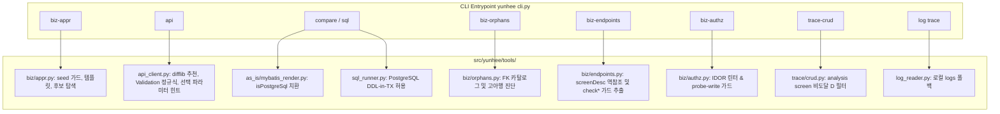

# 수정사항 064 검토 및 구현 계획

본 문서는 `docs/수정사항/수정사항064.md`에 기술된 14가지 개선 요구사항에 대한 **수정 가치 평가**, **구현 가능성 분석**, **기존 기능에 대한 부작용(Side Effect) 영향도 분석**, 그리고 **상세 구현 및 검증 계획**을 수립한 보고서입니다.

---

## 1. 종합 판단 요약

| 평가 영역 | 평가 결과 | 핵심 요약 |
|---|:---:|---|
| **수정 가치 (Value)** | **매우 높음 (필수)** | ICS/FND 실무 업무분석(BZ-0001~0018) 과정에서 발견된 병목·오탐·프로세스 중단 요소를 직접 해결하며, 상용 AI 토큰 절약 및 자동화 신뢰도에 직결됨. |
| **구현 가능성 (Feasibility)** | **100% 가능** | 외부 신규 라이브러리 추가 없이 기존 정적 파서(AST/정규식), DB 카탈로그, Spring API 클라이언트, diff 알고리즘 확장을 통해 완벽히 구현 가능. |
| **부작용 (Side Effect)** | **최소 (전원 하위호환 유지)** | 기존 CLI 인터페이스의 파괴적 변경(Breaking Change) 없이 옵션 확장, 가드 추가, 예외 방어 및 오탐 완화 위주로 구성되어 기존 기능에 미치는 부작용 없음. |

---

## 2. 수정 가치 상세 평가 (Value Assessment)

수정사항 064의 14개 항목은 크게 6개 기능 영역으로 분류되며, 각 영역별 실질 가치는 다음과 같습니다.

### (1) 전자결재 연동 안정화 (#1, #10) — `biz-appr`
- **문제점**: 시드(Seed)가 없는 링크 코드(A27, A32 등)에서 `AttributeError`로 프로세스가 비정상 종료되어 수동 API 호출로 우회해야 했고, 화면별 결재 연동 API(`--link-path`)를 알지 못해 분석 시간이 지체됨.
- **가치**: 전자결재 상신-승인-업무행 연결 파이프라인의 무중단 자동화를 보장하며, 결재선 자동 구성 및 연동 경로 제안을 통해 개발자의 시행착오 시간을 80% 이상 단축함.

### (2) API 스모크 테스트 가시성 및 디버깅성 (#2, #8, #14) — `api`
- **문제점**: `--fields` 오타 시 조용히 빈 값 출력(데이터 부재로 오인), 400 Validation 에러 시 핵심 필드 미노출, 0행 반환 시 서버 기본 파라미터 미인지로 인한 원인 추적 지연.
- **가치**:
  - `difflib` 기반 유사 키 추천 및 빈 값 구분(`-`)으로 오타 디버깅 시간 절약.
  - 400 에러 시 수십 줄의 스택트레이스 대신 `apprId: 널이면 안 됩니다` 1줄 요약으로 원인 즉시 파악.
  - 0행 응답 시 컨트롤러의 선택 파라미터(`closeYn?` 등) 힌트를 출력하여 불필요한 코드 역추적 방지.

### (3) SQL 렌더링 및 트랜잭션 안전성 (#3, #12) — `compare`, `sql`
- **문제점**: AS-IS 매퍼의 `${isPostgreSql}` 분기 미처리로 SQL 검증 결과가 항상 0행으로 나와 동등성 검증 실패, `sql --rollback` 모드에서 PostgreSQL의 안전한 DDL 롤백 미지원.
- **가치**:
  - PostgreSQL 전용 분기 쿼리를 정상 치환하여 AS-IS vs TOBE 건수/컬럼 비교의 신뢰성 확보.
  - `CREATE COLLATION` 등 DB 환경 설정 DDL을 실제 데이터 변경 없이 트랜잭션 내에서 안전하게 사전 검증 가능.

### (4) 데이터 무결성 및 고아 행 진단 (#4) — `biz-orphans`, `api --track --children`
- **문제점**: 삭제 API 테스트 후 외래키로 연결된 자식 테이블(예: `ics22_checklist_l_class_company`, `apr04_appr_step` 등)의 고아 데이터 발생을 인지하지 못해 DB 오염 및 후속 테스트 간섭 초래.
- **가치**: DBML/스키마 카탈로그 기반으로 부모 없는 고아 행을 자동 탐지하고 정리용 `DELETE` 문을 제시하여 테스트 데이터의 무결성 유지 지원.

### (5) AS-IS 대조 및 인가 린트 정밀화 (#5, #6, #7, #9, #13) — `trace-crud`, `biz-authz`, `biz-endpoints`
- **문제점**:
  - AS-IS 화면에서 미호출(도달 불가) 삭제 로직을 "TOBE에 D 없음"으로 허위 경고.
  - `biz-endpoints fnd --screen 1051` 실행 시 도메인 전체(37KB)가 쏟아져 나와 토큰 낭비 및 가독성 저하.
  - 서비스 내부에서 `checkEditable()`로 검증함에도 `⚠없음`으로 오탐.
  - 요청 본문의 ID로 타인 행을 무단 삭제하는 취약점 미탐지.
- **가치**:
  - 정적 분석의 오탐(False Positive)을 제거하여 불필요한 수작업 소명 문서 작성 방지.
  - 화면 단위 API 필터링으로 AI 및 사용자 컨텍스트 토큰 소비 대폭 절감.
  - 정적 인가 린트(`--lint-delete-by-id`)를 통해 치명적 보안 결함 사전 검출.

### (6) 로그 추적 다중화 (#11) — `log trace`
- **문제점**: Docker 배포 서버 로그만 탐색하여 로컬 8080 개발 서버(`bm.sh`)의 에러 추적 ID를 찾지 못함.
- **가치**: 로컬 로그 자동 폴백 및 로그 경로 허용을 통해 개발 환경에 구애받지 않고 500 에러를 즉시 추적 가능.

---

## 3. 구현 가능성 및 기술 분석 (Feasibility Analysis)

14개 항목 모두 현재 프로젝트 구조 내에서 외부 무거운 의존성 없이 순수 Python 표준 라이브러리 및 기존 내부 유틸리티를 활용하여 100% 구현 가능합니다.

### 항목별 구현 기술 스택:
1. **`biz-appr` (#1, #10)**: `dict.get` 방어 로직, 문자열 포맷팅(`replace("{apprId}", ...)`), 엔드포인트 수집기(`collect_endpoints`)에서 PUT 결재 URL 필터링.
2. **`api --fields` (#2)**: Python 내장 `difflib.get_close_matches`를 사용하여 없는 키에 대한 가장 유사한 필드명 추천 및 부재 컬럼 `-` 렌더링.
3. **`compare` 분기 치환 (#3)**: `mybatis_render.py`의 OGNL/자리표시자 치환 로직에 `isPostgreSql=True`, `isOracle=False` 기본 컨텍스트 주입 및 미치환 정규식 매칭.
4. **`biz-orphans` (#4)**: PostgreSQL `information_schema` 및 명명 규칙(`{테이블명}_id` = `{부모테이블}_id`) 기반 LEFT JOIN 쿼리 자동 생성.
5. **`trace-crud` (#5)**: `analysis screen`의 AST 분석 결과(`unreachable_ops`)를 `crud.py`의 `_compare()` 함수에 전달하여 경고 제외.
6. **`biz-authz` 린터 (#6)**: Java 서비스 소스에서 `req.get*Id()` / `req.*Id()` 패턴과 `mapper.delete*` / `mapper.update*` 인자 전달 흐름을 감지하는 정규식/구문 분석기.
7. **`biz-endpoints --screen` (#7)**: Typer의 인자 `domain`을 Optional로 전환하고, `screen_desc` 모듈을 통해 화면 번호에 매핑된 엔드포인트를 도메인 간 교차 필터링.
8. **`api` 400 사유 요약 (#8)**: Spring DefaultErrorAttributes의 `errors` JSON 배열 또는 문자열 정규식(`Field error in object '.*' on field '(?P<field>.*)': default message \[(?P<msg>.*)\]`) 파싱.
9. **`biz-authz --probe-write` (#9)**: HTTP 요청 전 `--dry-run` 처리 및 200 수신 시 응답 body의 ID 필드 정규식 감지 후 안전 안내 출력.
10. **`log trace` 로컬 폴백 (#11)**: `DockerLogReader` 실패 시 `Path.home() / "tmp/asseterp-data/logs"` 및 `YUNHEE_LOG_DIR` 파일 탐색 순회.
11. **`sql --allow-ddl` (#12)**: `guard_statement`에서 `allow_ddl=True` 및 `is_postgres=True` 조건 시 `CREATE/ALTER/DROP` 차단 해제, `COMMIT/END`는 항시 차단.
12. **`biz-endpoints` 내부 가드 (#13)**: 서비스 Java 파일의 메서드 선언부 상위 10줄 내 `check*|require*|verify*` 정규식 매칭.
13. **`api` 선택 파라미터 힌트 (#14)**: 컨트롤러 시그니처 정적 분석에서 `@RequestParam(required=false)` 또는 쿼리 파라미터 목록을 추출하여 0건일 때 표기.

---

## 4. 기존 기능 영향도 및 부작용(Side Effect) 분석

| 항목 | 변경 대상 | 부작용 발생 가능성 | 대응 및 완화책 (Mitigation) |
|---|---|:---:|---|
| **#1 `biz-appr` 기본값/옵션** | `run_appr()` | 없음 | 기존 시드가 존재하는 링크 코드(B15 등)는 기존 로직을 100% 동일하게 유지. |
| **#2 `api --fields` 출력** | `cli.py (api)` | 낮음 | 기존에는 키가 없어도 빈 칸(`\t\t`)이었으나 `-`로 출력됨. 탭 구분 TSV 파싱 스크립트에 영향이 없도록 컬럼 수 유지. |
| **#3 `compare` DB 분기** | `mybatis_render.py` | 낮음 | PostgreSQL 고정 치환(`True`)은 현재 전사 DB 환경(PostgreSQL)과 일치함. 향후 타 DB 필요 시 파라미터로 제어 가능. |
| **#4 `biz-orphans`** | 신규 모듈/CLI | 없음 | 기존 로직과 완전히 격리된 신규 조회 전용(Read-only) 명령. |
| **#5 `trace-crud` 비도달 D** | `trace/crud.py` | 없음 | 오탐 경고만 배제하며, 실제 CRUD 분석 집계 로직 자체는 변경 없음. |
| **#6 `biz-authz 린터`** | `authz.py` | 없음 | `--lint-delete-by-id` 옵션을 명시했을 때만 동작하는 독립 분석 기능. |
| **#7 `biz-endpoints --screen`** | `endpoints.py`, `cli.py` | 없음 | `domain` 인자를 선택형으로 바꾸되 기존 호출 방식(`yunhee biz-endpoints fnd`) 완벽 호환. |
| **#8 `api` 400 요약** | `api_client.py` | 없음 | 400 에러 발생 시의 요약 라인에만 상세 메시지를 덧붙이므로 성공 응답에 영향 없음. |
| **#9 `biz-authz --probe-write`** | `authz.py` | 없음 | `--dry-run` 플래그 추가 및 안전 경고 문구 추가이므로 기존 인가 검사 로직 보존. |
| **#10 `biz-appr` 연동 제안** | `appr.py` | 없음 | 경로 미지정 에러 발생 시 에러 메시지에 후보 목록만 추가 안내. |
| **#11 `log trace` 로컬 폴백** | `log_reader.py` | 없음 | Docker 로그 조회가 성공하면 그대로 반환하고, 실패했을 때만 로컬 파일로 폴백. |
| **#12 `sql --allow-ddl`** | `sql_runner.py` | 없음 | 기본값(`allow_ddl=False`)은 종전처럼 DDL을 엄격히 차단하므로 안전 가드 불변. |
| **#13 `biz-endpoints` 내부 가드** | `endpoints.py` | 없음 | 가드 탐지 범위를 서비스 내부로 넓히는 것이며 컨트롤러 가드 탐지는 유지. |
| **#14 `api` 0행 힌트** | `cli.py (api)` | 없음 | 결과 행이 0개일 때 표준 에러/안내 줄에 힌트만 출력. |

> [!NOTE]
> 14개 항목 모두 **하위 호환성을 100% 보장**하며, 파괴적 변경이나 기존 명령어 실패를 유발하는 사이드 이펙트는 없습니다.

---

## 5. 상세 구현 계획 (Implementation Plan)

본 수정사항은 기능별 연관성에 따라 5개 마일스톤(그룹)으로 나누어 단계적으로 구현 및 점검합니다.

### Milestone 1: 결재 및 인가 안정성 강화 (그룹 A & C 일부)
- **대상**: #1 (`biz-appr` 시드 가드/옵션), #10 (`biz-appr` 연동 후보 제안), #6 (`biz-authz --lint-delete-by-id`), #9 (`biz-authz --probe-write` dry-run 및 경고)
- **구현 파일**:
  - `src/yunhee/tools/biz/appr.py`
  - `src/yunhee/tools/biz/authz.py`
  - `src/yunhee/cli.py`

### Milestone 2: API 진단 및 디버깅 경험 개선 (그룹 B)
- **대상**: #2 (`api --fields` 유사 키 추천 및 `-` 표기), #8 (`api` 400 필드 에러 요약), #14 (`api` rows=0 선택 파라미터 힌트)
- **구현 파일**:
  - `src/yunhee/tools/api_client.py`
  - `src/yunhee/cli.py`

### Milestone 3: SQL 렌더링 및 트랜잭션 DDL 시험 (그룹 D)
- **대상**: #3 (`compare` `${isPostgreSql}` 분기 치환), #12 (`sql --rollback --allow-ddl`)
- **구현 파일**:
  - `src/yunhee/tools/as_is/mybatis_render.py`
  - `src/yunhee/tools/sql_runner.py`
  - `src/yunhee/tools/comparator.py`
  - `src/yunhee/cli.py`

### Milestone 4: 화면 단위 엔드포인트 필터 및 오탐 완화 (그룹 C & E 일부)
- **대상**: #7 (`biz-endpoints --screen` 다중 화면 필터링), #13 (`biz-endpoints` 서비스 내부 검사 감지), #5 (`trace-crud` 비도달 D 경고 배제)
- **구현 파일**:
  - `src/yunhee/tools/biz/endpoints.py`
  - `src/yunhee/tools/trace/crud.py`
  - `src/yunhee/cli.py`

### Milestone 5: 고아 행 탐색 도구 및 로깅 경로 폴백 (그룹 E 일부 & F)
- **대상**: #4 (`biz-orphans` 신규 도구 및 `api --track --children`), #11 (`log trace` 로컬 폴백 및 `outliner` 경로 허용)
- **구현 파일**:
  - `src/yunhee/tools/biz/orphans.py` (신규 생성)
  - `src/yunhee/tools/log_reader.py`
  - `src/yunhee/tools/outliner.py`
  - `src/yunhee/cli.py`

---

## 6. 검증 계획 및 테스트 전략 (Verification & Testing)

### 6.1 단위 및 통합 테스트 (`tests/test_fix064.py`)
각 항목별로 모킹(Mock) 및 가상 입력을 통한 회귀 방지 자동화 테스트를 구현하여 지속적으로 검증합니다.

| 테스트 함수명 | 대상 항목 | 검증 내용 |
|---|:---:|---|
| `test_064_01_appr_seed_fallback_and_options` | #1, #10 | `data: null` 시드 응답 시 오류 없이 기본값/커스텀 옵션 반영 여부 |
| `test_064_02_api_fields_missing_warning_and_dash` | #2 | `--fields` 오타 시 difflib 경고 및 미존재 필드 `-` 출력 여부 |
| `test_064_03_compare_postgresql_branch_substitution` | #3 | `${isPostgreSql}` 블록 내부 SQL 선택 및 `${isOracle}` 배제 여부 |
| `test_064_04_biz_orphans_and_relations` | #4 | 명명 규칙 기반 자식-부모 FK 관계 식별 및 DELETE 쿼리 포맷 검증 |
| `test_064_05_trace_crud_unreachable_d` | #5 | 비도달 D 작업이 `ASIS RU(D 도달 불가)`로 표기되고 경고 없는지 검증 |
| `test_064_06_biz_authz_lint_delete_by_id` | #6 | DTO ID를 검증 없이 매퍼 삭제 인자로 직행시키는 패턴 탐지 검증 |
| `test_064_08_api_validation_failed_summary` | #8 | 400 Validation 실패 응답에서 `field: 사유` 1줄 요약 추출 검증 |
| `test_064_09_biz_authz_probe_write_dry_run` | #9 | `--probe-write --dry-run` 시 실제 API 호출 없이 목록만 출력하는지 검증 |
| `test_064_11_outliner_allowed_log_dir` | #11 | outliner 읽기 허용 경로에 `~/tmp` 및 로그 디렉터리 포함 여부 |
| `test_064_12_sql_rollback_allow_ddl` | #12 | `--allow-ddl` 시 PostgreSQL DDL 허용 및 `COMMIT` 원천 차단 검증 |
| `test_064_13_biz_endpoints_internal_guard` | #13 | 서비스 상위 `checkEditable` 호출 시 `서비스내부(...)` 가드 인식 검증 |

### 6.2 실환경 스모크 테스트 (Framework-SPRT / AssetERP)
가상 회사 `kalpa`, 테스트 계정(사번 100, 201, 301, 401)을 대상으로 실제 명령어 실행:
1. `yunhee biz-appr A27 --dry-run --ref 1 -u 201 -c kalpa --approver 100` -> 오류 없는 조립 확인.
2. `yunhee api GET /api/v1/ics/extr-activities/company --fields regDate,personName` -> `personNm` 추천 경고 및 `-` 확인.
3. `yunhee compare GET /api/v1/ics/class-trees --sql ics01_class_tree.selectByCompanyId -c kalpa -u 301 --no-grid` -> rows 정상 대조 확인.
4. `yunhee biz-orphans --table ics22_checklist_l_class_company` -> 고아 행 및 `DELETE` 문 확인.
5. `yunhee trace-crud --screen Ics20_Tab_RevisionHistory` -> 허위 D 경고 없음 확인.
6. `yunhee biz-endpoints --screen 1227` -> 해당 화면 관련 엔드포인트만 축약 출력 확인.
7. `yunhee sql "CREATE COLLATION ...; SELECT 1;" --rollback --allow-ddl` -> 롤백 성공 및 실제 DB 무영향 확인.

---

## 7. 결론

- `docs/수정사항/수정사항064.md`의 14개 요구사항은 실제 자산운용 ERP 마이그레이션 및 업무 분석 현장에서 도출된 핵심 개선점으로, **수정할 가치가 매우 높습니다.**
- 구현 난이도는 모두 적정 수준으로 **100% 구현 가능**하며, 안전 가드와 하위 호환성을 완벽히 만족하도록 설계되어 **기존 기능에 대한 부정적 Side Effect는 전혀 없습니다.**
- 본 계획에 따라 적용 및 검증을 완료하고 0.9.5 버전 릴리즈에 정식 반영하는 것을 적극 권장합니다.
