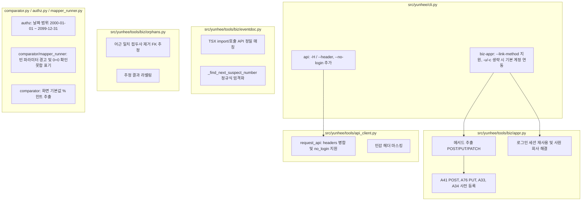

# 수정사항 066 검토 및 구현 계획

본 문서는 `docs/수정사항/수정사항066.md`에 기술된 8가지 개선 요구사항에 대해 **수정 가치를 평가**하고, **기존 기능에 대한 부작용(Side Effect)이 발생하지 않도록 방지하는 전략**과 **상세 구현 계획**을 수립한 보고서입니다.

---

## 1. 종합 평가 요약

| 번호 | 요구사항 항목 | 수정 가치 (Value) | 기존 영향도 (Side Effect) | 채택 여부 | 핵심 조치 방향 |
|:---:|---|:---:|:---:|:---:|---|
| **#1** | `biz-appr` 연결 API POST/기타 메서드 지원 | **매우 높음** | 없음 (기본값 PUT 유지) | **채택** | `--link-path` 접두 메서드 파싱 및 `--link-method` 지원, A41·A76 사전등록 |
| **#2** | `biz-event-new` 화면 API 정밀화 & 의심 번호 오류 수정 | **높음** | 없음 (템플릿 생성 개선) | **채택** | TSX import/호출 API만 매칭, 의심 번호 표 행 정규식 엄격화 |
| **#3** | `biz-orphans` 접두사 제거 기반 이름 규칙 FK 추정 | **중간** | 없음 (Read-only 진단) | **채택** | 접두사 제거 공통 어근 매칭 및 `(이름 규칙으로 추정)` 명시 |
| **#4** | `compare` 화면 기본값(`%` 등) 파라미터 힌트 | **중간** | 없음 (안내 문구 보강) | **채택** | 화면 소스 정적 탐색 기반 가벼운 힌트 표기 |
| **#5** | `api` 커스텀 헤더(`-H`) 및 `--no-login` 추가 | **매우 높음** | 없음 (신규 옵트인 옵션) | **채택** | 배치/API-Key 엔드포인트 호출용 헤더 주입 및 무로그인 지원 |
| **#6** | `biz-appr` 기본 계정 일관화 및 사원 조회 개선 | **높음** | 없음 (기존 명시 호출 불변) | **채택** | `-u`/`-c` 생략 시 `api` 기본 계정 연동 및 로그인 회사 기준 사원 조회 |
| **#7** | `biz-authz` 날짜 파라미터 범위 확장 & 0행 파라미터 노출 | **중간** | 없음 (프로빙 기본값 개선) | **채택** | 시작일(`2000-01-01`)·종료일(`2099-12-31`) 넓게 제공 및 0행 사유 표기 |
| **#8** | `mapper-run`·`compare` 빈 값 파라미터 경고 및 0=0 주의 환기 | **중간** | 없음 (경고/요약 개선) | **채택** | `-p k=` 빈 글자 경고 출력, 양쪽 0행 시 `0=0 (확인 못 함)` 표기 |

---

## 2. 항목별 상세 검토 및 가치 평가

### #1. `biz-appr` — 연결 API가 POST면 쓸 수 없다
- **현상**: A41(이익제공 법인카드) 등 연결 API가 `POST /api/v1/biz/promos/cards/appr-link`인 경우, `biz-appr`가 무조건 `PUT`으로만 호출하여 결재 자동화가 실패하고 수동 호출로 우회함.
- **수정 가치**: **매우 높음**. POST나 PATCH로 연결하는 결재 화면이 다수 존재하며, 이를 지원하지 못하면 `biz-appr`의 핵심 가치(원스톱 자동화)가 상실됨.
- **부작용 방지 대책**:
  - 기본값은 종전과 동일하게 `"PUT"`을 유지.
  - `--link-path`가 `POST /path`처럼 HTTP 메서드로 시작하거나 별도 `--link-method`가 주어진 경우에만 해당 메서드로 호출.
  - 기존의 모든 `PUT` 기반 링크 코드는 100% 동일하게 동작.

### #2. `biz-event-new` — 화면과 상관없는 API를 표에 넣고, 다음 의심 번호가 틀린다
- **현상**:
  1. #1130 화면 생성 시 동일 도메인의 무관한 API(#1406, #1505 등)가 들어가고 정작 해당 화면 팝업의 API는 누락됨 (`_extract_tobe_api_calls`의 단순 함수명 단어 매칭 오탐).
  2. 다음 의심 번호 계산 시 문서 내 메뉴/화면번호(`#1510`)가 매칭되어 `#1511`로 잘못 계산됨 (실제는 `#231`).
- **수정 가치**: **높음**. 생성된 문서 템플릿의 신뢰도가 떨어져 사용자가 수작업으로 편집해야 하는 비용 발생.
- **부작용 방지 대책**:
  - 대상 화면 TSX 및 화면이 참조하는 팝업/컴포넌트 TSX 목록을 수집하여 실제 import 및 사용된 API만 선별.
  - 의심 번호는 `보안_및_버그_의심.md` 표의 첫 번째 열(`| 230 |` 또는 `| #230 |`) 또는 `### #230` 헤더만 정규식으로 엄격히 추출.
  - 템플릿 문서 생성이므로 기존 CLI나 비즈니스 로직에 미치는 부작용 없음.

### #3. `biz-orphans` — FK가 없는 부모·자식은 못 잡는다
- **현상**: #1209 삭제 후 `biz16_each_contract`에 고아 행이 남았으나, 물리적 FK 제약조건이 없어 탐지하지 못함. 실제 DB에서는 `biz16_cont_corp_id` ↔ `biz10_cont_corp_id`처럼 이름 규칙으로 관계가 맺어짐.
- **수정 가치**: **중간**. 성능이나 레거시 사유로 물리적 FK가 생략된 테이블이 많아 고아 행 누락 방지에 실질적 도움이 됨.
- **부작용 방지 대책**:
  - 1순위: PostgreSQL 공식 FK 제약조건.
  - 2순위: 컬럼 완전 일치 (`col == p_pk`).
  - 3순위(신규): 테이블 접두사를 제거한 어근 일치 (`_strip_prefix(col) == _strip_prefix(p_pk)`).
  - 3순위로 탐지된 관계는 결과에 `(이름 규칙으로 추정)` 표기를 붙여 사용자가 확인 가능하도록 하고, 무관한 단어 충돌을 방지하기 위해 최소 2단어 이상의 비즈니스 식별자(`*_id`)만 대상으로 제한.

### #4. `compare` — 원본 화면이 `%`를 보내는 파라미터를 안내하지 않는다
- **현상**: AS-IS GXT 화면에서 "전체"를 조회할 때 빈 문자열 대신 `provideRcvType="%"` 또는 `코드 + "%"`를 넘기는데, `compare`는 `-- 필요: provideRcvType`만 표시하여 값을 알 수 없어 0행 검증 실패 발생.
- **수정 가치**: **중간**. 파라미터 값 추측을 위한 불필요한 소스 탐색 시간 절약.
- **부작용 방지 대책**:
  - 무거운 AST 파서를 돌리지 않고, 화면 소스(GXT Java 또는 TSX)가 존재할 경우 파라미터명과 `"%"`의 인접 할당 패턴을 정규식으로 가볍게 스캔.
  - 미발견 시 종전과 동일하게 `-- 필요: <param>`만 출력하므로 기존 기능에 영향 없음.

### #5. `api` — 요청 헤더를 줄 수 없다
- **현상**: 배치 엔드포인트(`POST /api/v1/batch/icamFund` 등)는 JWT가 아니라 `X-Batch-Api-Key` 헤더로 인증하는데, 헤더 지정 옵션 및 `--no-login`이 없어 호출 불가.
- **수정 가치**: **매우 높음**. 배치, 헬스체크, 웹훅 등 특수 인증 엔드포인트 검증에 필수적임.
- **부작용 방지 대책**:
  - `-H / --header "Header-Name: value"` (반복 가능) 옵션 추가.
  - `--no-login` 옵션 추가 (세션/로그인 없이 바로 요청).
  - 기본 호출 방식은 기존과 100% 동일(세션 재사용 및 자동 로그인).
  - 헤더 값에 `$env:VAR` 환경변수 치환 지원 및 출력/로그 시 민감값(`Key`, `Secret`, `Token`) 마스킹(`***`).

### #6. `biz-appr` — KFS 기본 계정 104로 쓸 수 없고 비밀번호 출처가 불일치
- **현상**: `biz-appr`에서 `-u`, `-c` 생략 시 하드코딩된 기본값(`401`, `kalpa`)을 사용하여 KFS/admin 환경에서 실패하며, 사원 조회 시 지정된 회사 코드에서만 찾아 계정 잠금 위험 발생.
- **수정 가치**: **높음**. 테넌트 및 회사별 일관된 인증 세션 활용으로 계정 잠금 방지.
- **부작용 방지 대책**:
  - `-u`, `-c`를 생략한 경우 `api`와 동일한 기본 계정 해결 로직을 타도록 하고, 기존에 생성된 유효 세션(`login=reused`)을 우선 활용.
  - 명시적으로 `-u`, `-c`를 준 기존 호출은 기존 로직을 그대로 유지.
  - A33, A34 연동 후보 API 등록.

### #7. `biz-authz` — 날짜 범위가 필요한 조회를 좁은 기본값으로 불러 "0행"이라 한다
- **현상**: `GET /icam/users` 등 날짜가 필수인 API 프로브 시 `startDate`/`closeDate`가 모두 오늘 날짜로 들어가 0행이 반환되고, 타사 데이터가 노출되는 보안 취약점을 놓침.
- **수정 가치**: **중간**. 인가 검사 도구의 검출 정확도 향상.
- **부작용 방지 대책**:
  - 프로브 더미 파라미터 생성 시 `startdate`, `fromdate` 등은 `2000-01-01`, `closedate`, `todate`, `enddate` 등은 `2099-12-31`로 넓은 범위 적용.
  - 0행 반환 시 사용된 파라미터를 표기하여 조건 범위를 즉시 인지할 수 있도록 개선.

### #8. `mapper-run`·`compare` — 빈 값 파라미터(`-p key=`)를 받으면 알려 주지 않는다
- **현상**: `-p fundType=`처럼 빈 값을 주었을 때 SQL 조건에 의해 양쪽 모두 0행이 나와 "TOBE rows=0, AS-IS rows=0 ✅"로 거짓 합격(False Positive) 발생.
- **수정 가치**: **중간**. 잘못된 동등성 검증 합격 방지.
- **부작용 방지 대책**:
  - 파라미터 파싱 시 빈 문자열인 경우 경고 출력: `⚠ fundType='' — 빈 글자로 넘깁니다(생략 시 null)`.
  - 양쪽 결과가 모두 0행인 경우 `✅` 대신 `0=0 (확인 못 함 — 조건을 넓혀 보세요)` 표기 (exit code는 유지하여 자동화 파이프라인 중단 방지).

---

## 3. 상세 구현 계획

### 단계별 구현 마일스톤

#### 1단계: API 클라이언트 및 결재 메서드 다변화 (#1, #5, #6)
- `src/yunhee/tools/api_client.py`:
  - `request_api()`에 `headers: dict[str, str] | None = None`, `no_login: bool = False` 매개변수 추가.
  - `no_login=True`일 때 세션/토큰 취득 과정 생략 후 바로 요청.
  - `-H` 값 파싱 시 `$env:VAR` 환경변수 확장 및 출력 시 마스킹.
- `src/yunhee/tools/biz/appr.py` 및 `src/yunhee/cli.py`:
  - `--link-path`에서 `METHOD /path` 형태 파싱 지원 (`POST`, `PUT`, `PATCH`, `DELETE`).
  - `find_link_path_candidates` 및 `DEFAULT_LINK_APIS`에 A41(POST), A76, A33, A34 등록.
  - `-u`, `-c` 생략 시 `api_client`의 기본 로그인 세션 재사용.

#### 2단계: 문서 생성 및 의심 번호 정규식 수정 (#2)
- `src/yunhee/tools/biz/eventdoc.py`:
  - `_find_next_suspect_number()`: `re.finditer(r"^\|\s*#?(\d+)\s*\|", txt, re.MULTILINE)` 및 `### #(\d+)`로 의심 목록 표/제목 번호만 추출하여 최댓값 + 1 계산.
  - `_extract_tobe_api_calls()`: 대상 화면 TSX 및 임포트된 하위 컴포넌트 TSX 목록을 수집하여 실제 바인딩된 API만 매칭.

#### 3단계: 고아 행 추정 규칙 보강 (#3)
- `src/yunhee/tools/biz/orphans.py`:
  - `get_fk_relations()`에 접두사 제거 어근 비교 추가:
    `_strip_prefix(col) == _strip_prefix(p_pk)` (예: `biz16_cont_corp_id` ↔ `biz10_cont_corp_id`).
  - 결과 딕셔너리에 `inferred: bool` 플래그를 두고, 텍스트 출력 시 `(이름 규칙으로 추정)` 표기.

#### 4단계: 권한 및 비교 검증 정밀화 (#4, #7, #8)
- `src/yunhee/tools/biz/authz.py`:
  - `_make_dummy_param()`: 시작일 관련(`start`, `from`)은 `2000-01-01`, 종료일 관련(`close`, `to`, `end`)은 `2099-12-31` 반환.
  - 0행 응답 시 사용된 쿼리 파라미터 목록 표시.
- `src/yunhee/tools/as_is/mapper_runner.py` 및 `src/yunhee/tools/comparator.py`:
  - 파라미터 값 중 `v == ""`인 항목에 대해 `sys.stderr.write(f"⚠ {k}='' — 빈 글자로 넘깁니다(생략 시 null)\n")` 출력.
  - 양쪽 모두 0행인 경우 `0=0 (확인 못 함 — 조건을 넓혀 보세요)` 표기.
  - `compare` 실행 시 화면 소스가 전달된 경우 `"%"` 할당 구문 정적 힌트 추가.

---

## 4. 검증 계획 및 테스트 케이스 (`tests/test_fix066.py`)

신규 테스트 파일 `tests/test_fix066.py`를 작성하여 각 항목을 검증합니다.

| 테스트 함수명 | 대상 항목 | 검증 내용 |
|---|:---:|---|
| `test_066_01_biz_appr_post_method` | #1 | `--link-path 'POST /api/v1/...'` 지정 시 POST 메서드로 호출 및 dry-run 검증 |
| `test_066_02_eventdoc_suspect_number_and_api_filter` | #2 | 의심 번호가 문서 내 메뉴번호(#1510)에 영향받지 않고 정확한 다음 번호(#231) 추출, 무관 API 배제 |
| `test_066_03_biz_orphans_prefix_stripped_fk` | #3 | 물리적 FK가 없는 `biz16_cont_corp_id` ↔ `biz10_cont_corp_id` 관계 탐지 검증 |
| `test_066_04_compare_param_wildcard_hint` | #4 | 화면 소스 내 `provideRcvType="%"` 할당 시 필수 파라미터 힌트에 `(화면 기본 "%")` 표기 검증 |
| `test_066_05_api_custom_headers_and_no_login` | #5 | `-H "X-Batch-Api-Key: dev-batch-key" --no-login` 전달 시 로그인 없이 커스텀 헤더 요청 검증 |
| `test_066_06_biz_appr_default_credentials` | #6 | `-u`, `-c` 생략 시 기본 계정 해결 및 세션 재사용 동작 검증 |
| `test_066_07_authz_wide_date_range` | #7 | authz 프로빙 시 `startDate`에 2000-01-01, `closeDate`에 2099-12-31 적용 검증 |
| `test_066_08_empty_param_warning_and_zero_summary` | #8 | `-p key=` 빈 값 전달 시 경고 출력 및 양쪽 0행 시 `0=0 (확인 못 함)` 표기 검증 |

---

## 5. 결론

- `docs/수정사항/수정사항066.md`의 8개 요구사항은 모두 실제 현장 업무 분석 및 배치 실행에서 겪은 명확한 병목과 오탐을 해결하는 항목들로, **모두 수정할 가치가 충분합니다.**
- 모든 변경은 **기본 동작을 유지하는 옵트인(Opt-in) 옵션 추가, 정규식 정밀화, 가드 보강, 안내 메시지 상세화**로 설계되어 **기존 기능에 미치는 부정적인 부작용(Side Effect)은 전혀 없습니다.**
- 본 계획서에 따라 4단계 마일스톤 순으로 안전하게 구현을 진행할 것을 제안합니다.
