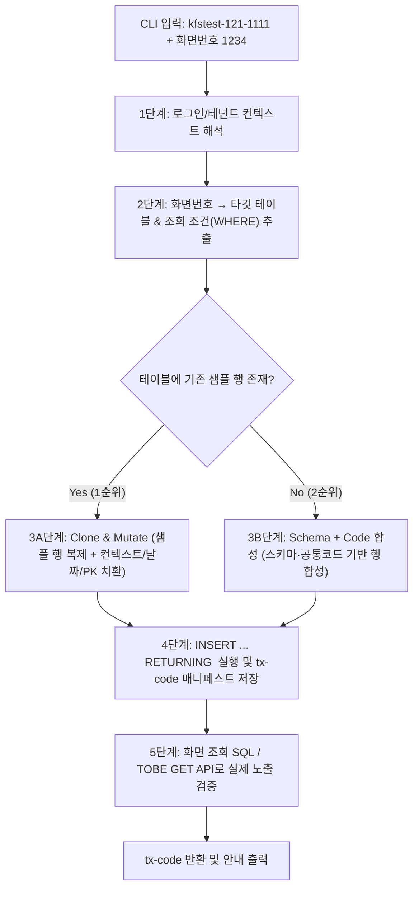

# 화면별로 테스트 데이터 만들기 설계 및 구현 계획서 (`test-insert-data` / `test-rollback-data`)

사용자가 특정 계정(예: `kfstest-121-1111`)으로 로그인해 특정 화면번호(예: `1234`)를 열었을 때, 빈 화면이 아니라 **즉시 조회·테스트 가능한 더미 데이터**가 화면에 표시되도록 DB에 데이터를 생성(`test-insert-data`)하고, 테스트 종료 후 발급받은 `transaction-code`로 안전하게 원상복구(`test-rollback-data`)하는 기능을 설계한다.

---

## 1. 명령어 인터페이스 (CLI UX)

### 1.1 `yunhee test-insert-data` (테스트 데이터 생성)

```bash
# 기본 사용법: <login-spec> <screen-no>
uv run yunhee test-insert-data kfstest-121-1111 1234

# 슬래시(/) 구분자 및 login= 접두사도 호환 지원
uv run yunhee test-insert-data kfstest/121/1111 1234

# 옵션 지정 예시
uv run yunhee test-insert-data kfstest-121-1111 1234 -n 3 --dry-run
uv run yunhee test-insert-data kfstest-121-1111 1234 --verify-api
```

#### 출력 예시
```text
🔍 [1234] 화면 분석: Ast01_Tab_AssetList (메인 테이블: ast01_asset, 상세: ast02_asset_dtl)
👤 로그인 컨텍스트: company=kfstest (comp_id=1004), emp_no=121 (emp_id=5021, org_id=3012)
📝 데이터 생성 완료 (방식: 기존 샘플 복제 + 컨텍스트 치환):
  - ast01_asset: 3건 INSERT (pk: 990101, 990102, 990103)
  - ast02_asset_dtl: 3건 INSERT (pk: 880201, 880202, 880203)
✅ 화면 조회 검증: GET /api/v1/ast/assets → 3건 조회 확인
🔑 Transaction Code: tx-1234-20261117-a8f2
👉 롤백 명령어: yunhee test-rollback-data kfstest-121-1111 tx-1234-20261117-a8f2
```

#### 인자 및 옵션 규격 (`test-insert-data`)

| 인자 / 옵션 | 기본값 | 설명 |
| :--- | :--- | :--- |
| `<login>` | (필수) | `<company>-<user>-<password>` 또는 `<company>/<user>/<password>` 형식 (예: `kfstest-121-1111`) |
| `<screen_no>` | (필수) | 대상 화면번호(예: `1234`, `1029`) 또는 화면 클래스명 |
| `-n`, `--count` | `3` | 메인 테이블 기준으로 생성할 테스트 행 수 |
| `--table`, `-t` | 자동 추론 | 자동 추론된 테이블 대신 특정 테이블만 강제 지정 (쉼표 구분 가능) |
| `--dry-run` | `False` | 실제 커밋하지 않고 트랜잭션 내에서 INSERT 및 SELECT 검증만 수행 후 롤백 (생성 SQL 출력) |
| `--verify-api` / `--no-verify-api` | `True` | INSERT 직후 해당 화면의 TOBE 조회 API(또는 메인 조회 SQL)를 실행해 실제로 건수가 조회되는지 확인 |
| `--db` | 기본 DB (`LOCAL_DB`) | 대상 데이터베이스 환경변수 이름 |

---

### 1.2 `yunhee test-rollback-data` (테스트 데이터 삭제/원상복구)

```bash
# 기본 사용법: <login-spec> <transaction-code>
uv run yunhee test-rollback-data kfstest-121-1111 tx-1234-20261117-a8f2

# 편의 옵션: 현재 활성(미롤백) 트랜잭션 목록 조회
uv run yunhee test-rollback-data --list

# 편의 옵션: 해당 계정에서 가장 마지막에 넣은 트랜잭션 즉시 롤백
uv run yunhee test-rollback-data kfstest-121-1111 --last

# 편의 옵션: 특정 화면번호로 생성된 활성 트랜잭션 일괄 롤백
uv run yunhee test-rollback-data kfstest-121-1111 --screen 1234
```

#### 출력 예시
```text
⏪ 롤백 시작: tx-1234-20261117-a8f2 (화면: 1234, 계정: kfstest-121)
  - DELETE FROM ast02_asset_dtl WHERE ast02_dtl_id IN (880201, 880202, 880203) → 3건 삭제
  - DELETE FROM ast01_asset WHERE ast01_asset_id IN (990101, 990102, 990103) → 3건 삭제
✔ 롤백 완료: tx-1234-20261117-a8f2 (상태: ROLLED_BACK)
```

#### 인자 및 옵션 규격 (`test-rollback-data`)

| 인자 / 옵션 | 기본값 | 설명 |
| :--- | :--- | :--- |
| `<login>` | (`--list` 외 필수) | 생성 시 사용한 `<company>-<user>-<password>` (계정 오작동 방지용 소유자 대조) |
| `<tx_code>` | 선택 | 롤백할 `transaction-code` (예: `tx-1234-20261117-a8f2`) |
| `--list` | `False` | 현재 워크스페이스의 테스트 데이터 생성 이력 및 상태(`ACTIVE` / `ROLLED_BACK`) 테이블 출력 |
| `--last` | `False` | 해당 `<login>`으로 생성한 가장 최근 `ACTIVE` 트랜잭션 1건 롤백 |
| `--screen` | `None` | 해당 `<login>` + 화면번호에 속한 모든 `ACTIVE` 트랜잭션 일괄 롤백 |
| `--cascade-children` | `True` | 사용자가 화면 테스트 중 해당 PK 아래에 추가로 생성한 하위 테이블 자식 행(FK 참조 행)도 함께 탐지·삭제 |
| `--dry-run` | `False` | 실행될 DELETE 문과 삭제 예상 건수만 확인하고 롤백 |

---

## 2. 아키텍처 및 내부 실행 파이프라인



### 단계별 상세 설계

#### 1단계: 로그인/테넌트 컨텍스트 해석 (`Context Resolver`)
- 입력받은 `kfstest-121-1111`을 파싱하여 `(company_cd="kfstest", login_id="121", password="1111")`로 분리한다.
- DB에서 해당 테넌트·사원의 핵심 식별자를 조회하여 **Context Dictionary**를 만든다:
  - 회사 정보 (`sys01_company`): `comp_id`, `comp_cd` (`kfstest`), `comp_nm`
  - 사원/인사 정보 (`emp01_person`, `emp02_emp` / `emp04_add_title`): `emp_id`, `person_id`, `emp_no` (`121`), `emp_nm`, `org_id`(부서 ID), `pos_cd`(직위), `duty_cd`(직책)
  - 기준 날짜: `today` (`CURRENT_DATE`), `yyyymmdd` (`20261117`), `yyyymm` (`202611`), `yyyy` (`2026`)

#### 2단계: 화면번호 → 대상 테이블 및 조회 필터 분석 (`Screen Target Analyzer`)
기존 `yunhee` 도구를 조합하여 대상 테이블과 필수 조건을 결정론적으로 추출한다:
1. **화면 메타 조회** (`src/yunhee/tools/trace/screen_desc.py`, `crud.py`):
   - `<screen_no>`에 연결된 TOBE 엔드포인트(`GET /api/v1/...`), MyBatis Mapper XML SQL ID, 참조 테이블 목록 및 C/R/U/D 매트릭스를 가져온다.
2. **타깃 테이블 선정 (마스터/공통 테이블 배제 규칙)**:
   - 화면이 `C/U/D` 하는 테이블이 있으면 1순위로 선정한다.
   - 조회 전용 화면(`R`만 존재)인 경우, 메인 조회 SQL의 `FROM <main_table>` 테이블을 선정한다.
   - **제외 블랙리스트(Exclusion List)**:
     - 시스템/공통/코드/메뉴 테이블: `sys01_company`, `sys02_*`, `sys08_code_kind`, `sys09_code`, `sys10_menu` 등
     - 인사/조직 기본 마스터(타 도메인 화면에서 단순 조인용으로 쓰일 때): `emp01_person`, `org01_org` 등 (단, 인사/조직 관리 화면 자체인 경우는 예외)
3. **조회 SQL `WHERE` 절 & `JOIN` 조건 스캔**:
   - 화면의 메인 `SELECT` 쿼리에서 필터링에 쓰이는 컬럼 패턴을 추출한다:
     - 테넌트/소유자 필터: `*_comp_id`, `*_emp_id`, `*_org_id`, `*_dept_id`, `*_reg_emp_id`
     - 날짜/기간 필터: `*_dt`, `*_ymd`, `*_ym`, `*_year` → 화면 기본 조회 기간에 걸리도록 **오늘(`CURRENT_DATE`) 또는 이번 달**로 설정
     - 고정 상태/구분 필터: 예: `WHERE del_yn = 'N'`, `use_yn = 'Y'`, `appr_stat_cd = '30'` 등 리터럴 조건이 있으면 생성할 데이터에 그대로 반영

#### 3단계: 테스트 데이터 생성 엔진 (`Data Synthesizer`)

실제 ERP DB의 복잡한 도메인 규칙·공통코드·FK 제약을 가장 확실하게 만족시키기 위해 **2단계 폴백(Fallback) 전략**을 사용한다.

##### 전략 A (1순위): `Clone & Mutate` (기존 데이터 샘플링 및 변형)
- 대상 테이블에 이미 존재하는 행(다른 회사 `kalpa`의 데이터나 과거 날짜 데이터 포함)을 `SELECT * FROM <table> ORDER BY <pk> DESC LIMIT 5`로 조회한다.
- 샘플 행이 존재하면 이를 템플릿으로 복제하되 다음 컬럼들만 변형(Mutate)한다:
  1. **PK 컬럼**:
     - `SERIAL` / `IDENTITY` / `DEFAULT nextval(...)`가 있으면 `INSERT` 대상 컬럼에서 생략하거나 새 시퀀스 할당
     - 수동 채번(`BIGINT` / `VARCHAR`)이면 `SELECT COALESCE(MAX(pk), 0) + 1` 또는 AS-IS `f_seq()` 규칙으로 새 PK 부여
  2. **컨텍스트 컬럼 치환**:
     - 회사 ID 컬럼(`*_comp_id`, `comp_id`) → `kfstest`의 `comp_id`
     - 사원 ID 컬럼(`*_emp_id`, `*_user_id`, `*_reg_id`) → `121` 사원의 `emp_id`
     - 부서 ID 컬럼(`*_org_id`, `*_dept_id`) → `121` 사원의 `org_id`
  3. **날짜 컬럼 현재화**:
     - 조회 조건에 걸리는 기준일/시작일/신청일 컬럼 → 오늘 날짜(`CURRENT_DATE`) 또는 이번 달로 치환
     - 종료일(`*_end_dt`, `*_close_dt`) → 오늘 날짜 + 30일 등 시작일 이후로 보정
  4. **문자열 식별/표시**:
     - 제목/비고/명칭 컬럼(`*_nm`, `*_title`, `*_note`, `*_rmk`)에 `[TEST-1234] ...` 접두사를 붙여 화면에서 테스트 데이터임을 한눈에 알아볼 수 있게 표시 (컬럼 길이 제약 `VARCHAR(N)` 내로 절삭)
  5. **Unique 제약 회피**:
     - Unique Index가 걸린 코드/번호 컬럼(`*_cd`, `*_no`)은 접미사로 난수/시퀀스를 부여해 중복 충돌 방지

##### 전략 B (2순위): `Schema + CommonCode` 기반 합성 (테이블이 0건일 때)
- 테이블이 완전히 비어 있다면 `schema_snapshot`의 컬럼 타입·제약조건과 `biz-code`(`sys09_code`)를 조합해 값을 합성한다:
  - FK 컬럼: 부모 테이블에서 현재 회사(`kfstest`)의 유효 PK 1건을 `SELECT`하여 바인딩
  - 공통코드 컬럼(`*_cd`): 컬럼 코멘트나 매퍼의 `f_cdnm('KindCode', ...)` 호출식에서 코드 종류를 찾아 `sys09_code`의 실제 유효 코드값 바인딩
  - 숫자/금액(`numeric`, `int`): `10000`, `1` 등 기본 양수값
  - 여부(`*_yn`, `boolean`): `'Y'` / `'N'` 또는 `true` / `false` (`del_yn`은 `'N'`, `use_yn`은 `'Y'`)

#### 4단계: 안전한 트랜잭션 실행 및 `tx-code` 매니페스트 기록
1. **안전 가드 (`check_db_write_allowed`)**:
   - `src/yunhee/tools/biz/dbwrite.py`의 안전 가드를 그대로 재사용하여 **로컬/허용된 DB에서만** 실행되도록 강제한다.
2. **`INSERT ... RETURNING <pk_cols>` 실행**:
   - 부모 테이블 → 자식 테이블 순서로 단일 트랜잭션 내에서 실행하며, `RETURNING` 절로 실제 삽입된 각 행의 PK 값을 정확히 수집한다.
   - 만약 실패하면 즉시 `conn.rollback()` 되어 DB에는 아무 흔적도 남지 않는다.
3. **트랜잭션 매니페스트 저장 (`.yunhee/test-data/<tx_code>.json`)**:
   - `WORK_DIR/.yunhee/test-data/` 아래에 JSON 파일로 영구 기록한다.

```json
{
  "tx_code": "tx-1234-20261117-a8f2",
  "status": "ACTIVE",
  "screen_no": "1234",
  "screen_name": "Ast01_Tab_AssetList",
  "login": "kfstest-121-1111",
  "company_cd": "kfstest",
  "company_id": 1004,
  "emp_no": "121",
  "emp_id": 5021,
  "created_at": "2026-11-17T15:45:00+09:00",
  "rolled_back_at": null,
  "operations": [
    {
      "seq": 1,
      "table": "ast01_asset",
      "pk_columns": ["ast01_asset_id"],
      "inserted_pks": [[990101], [990102], [990103]]
    },
    {
      "seq": 2,
      "table": "ast02_asset_dtl",
      "pk_columns": ["ast02_dtl_id"],
      "inserted_pks": [[880201], [880202], [880203]]
    }
  ]
}
```

#### 5단계: 사후 검증 (`Post-Insert Verification`)
- 데이터가 실제로 화면에서 조회되는지 즉시 검증한다:
  - TOBE 백엔드 서버가 떠 있다면 `api_client.py`로 `kfstest / 121 / 1111` 로그인 후 해당 화면의 조회 API(`GET /api/v1/...`)를 호출해 반환 행 수(`row_count > 0`)를 확인한다.
  - 서버가 떠 있지 않다면 화면의 매퍼 `SELECT` 쿼리를 읽기 전용으로 실행해 결과 건수를 확인한다.

---

## 3. 롤백(`test-rollback-data`) 상세 설계

1. **매니페스트 로드 및 검증**:
   - `.yunhee/test-data/<tx_code>.json` 파일을 읽는다.
   - 이미 `status == "ROLLED_BACK"`이면 중복 실행을 막고 안내 메시지를 출력한다.
   - 인자로 받은 `<login>`(`kfstest-121`)과 매니페스트의 생성 계정이 다르면 경고를 띄우거나 차단한다 (`--force` 시 허용).
2. **파생 자식 행(Cascade Children) 자동 탐지 (`orphans.py` 연계)**:
   - 사용자가 화면에서 테스트 데이터를 가지고 추가 작업(결재 상신, 하위 상세 추가 등)을 수행했을 경우, 매니페스트에 없던 자식 테이블 행이 생겼을 수 있다.
   - 스키마 스냅샷의 FK 그래프를 참조하여, 삭제 대상 부모 PK를 참조하고 있는 하위 테이블의 자식 행들을 먼저 찾아 삭제 목록 앞단에 추가한다.
3. **역순(Reverse Order) 원자적 DELETE 실행**:
   - `operations`의 `seq` 역순(자식 테이블 → 부모 테이블)으로 단일 트랜잭션 안에서 `DELETE FROM <table> WHERE <pk> IN (...)`를 실행한다.
   - 복합 PK(`(col1, col2)`)인 경우에도 `WHERE (col1, col2) IN ((v1, v2), ...)` 구문으로 정확히 삭제한다.
4. **매니페스트 상태 갱신**:
   - 커밋 성공 시 매니페스트의 `status`를 `"ROLLED_BACK"`, `rolled_back_at`을 현재 시각으로 업데이트한다.

---

## 4. 모듈 구조 및 변경/추가될 파일 계획

기존 `yunhee`의 아키텍처 원칙(Tools 레이어 부수효과 격리 및 `ToolResult` 반환)에 맞춰 다음과 같이 구성한다.

| 파일 경로 | 구분 | 역할 및 구현 내용 |
| :--- | :--- | :--- |
| `src/yunhee/tools/biz/testdata.py` | **신규** | 핵심 비즈니스 로직 모듈:<br>- `resolve_login_context()`: `kfstest-121-1111` → 회사/사원/부서 ID 조회<br>- `analyze_screen_targets()`: 화면번호 → 타깃 테이블, PK/FK, 조회 SQL `WHERE` 조건 추출<br>- `synthesize_insert_sqls()`: Clone & Mutate 및 스키마 기반 INSERT 문 생성<br>- `insert_test_data()`: `INSERT ... RETURNING` 실행 및 매니페스트(`.yunhee/test-data/`) 기록<br>- `rollback_test_data()`: 매니페스트 역순 DELETE 및 파생 자식 행 정리<br>- `list_test_transactions()`: 생성/롤백 이력 조회 |
| `src/yunhee/cli.py` | **수정** | CLI 서브커맨드 2개 등록:<br>- `@app.command(name="test-insert-data")`<br>- `@app.command(name="test-rollback-data")` |
| `tests/test_testdata.py` | **신규** | 단위 테스트:<br>- 로그인 문자열(`kfstest-121-1111`, `kfstest/121/1111`) 파싱 테스트<br>- 타깃 테이블 필터링(공통/마스터 테이블 제외) 테스트<br>- 샘플 행 Mutate(회사/사원/날짜/PK 치환) 로직 테스트<br>- 매니페스트 저장 및 역순 DELETE SQL 생성 테스트 |
| `docs/help/` 및 `GEMINI.md` | **수정** | `test-insert-data`, `test-rollback-data` 사용법 문서화 |

---

## 5. 단계별 구현 순서 (Milestone)

1. **Step 1 — 컨텍스트 해석기 & 매니페스트 저장소 구현**
   - `kfstest-121-1111` 파싱 및 DB 내 회사/사원/부서 ID 조회 구현
   - `.yunhee/test-data/<tx_code>.json` 읽기/쓰기 및 `--list` 조회 구현
2. **Step 2 — 화면번호 기반 타깃 테이블 및 조건 분석기 구현**
   - `screen_desc` / `crud` 연동으로 화면번호 → 메인/상세 테이블 식별 및 마스터 테이블 제외 필터 구현
   - 매퍼 XML의 메인 `SELECT` 쿼리에서 날짜·회사·사원·상태값 `WHERE` 조건 추출
3. **Step 3 — `Clone & Mutate` 및 `Schema Synthesis` 생성기 구현**
   - 기존 행 샘플링 후 PK/회사/사원/날짜/비고 치환 `INSERT ... RETURNING` 실행기 구현
   - 빈 테이블용 스키마 + 공통코드(`sys09_code`) 기반 폴백 생성기 구현
4. **Step 4 — `test-rollback-data` 역순 삭제 및 FK 자식 행 정리 구현**
   - 매니페스트 역순 `DELETE` 실행기 및 파생 자식 행 탐지 삭제 구현
5. **Step 5 — CLI 연결, API 조회 검증(`--verify-api`), 단위 테스트 작성**
   - `cli.py` 등록 및 실제 화면번호 대상 E2E 검증
